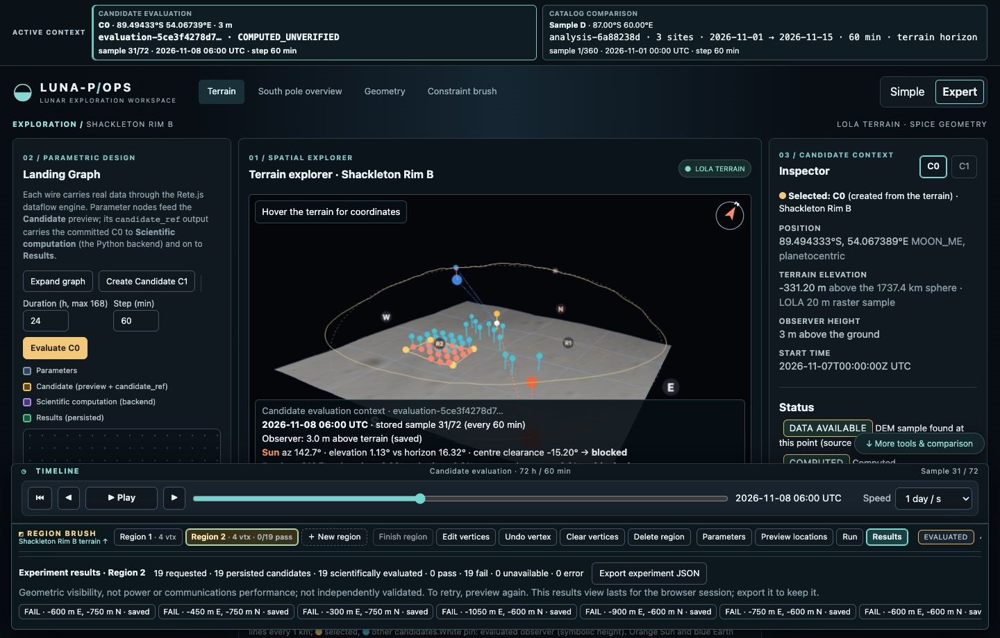
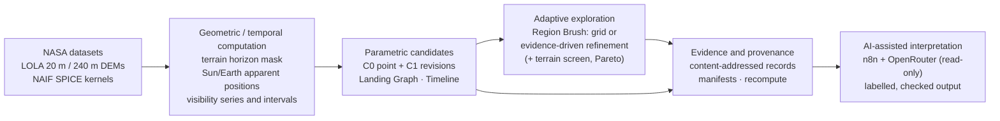
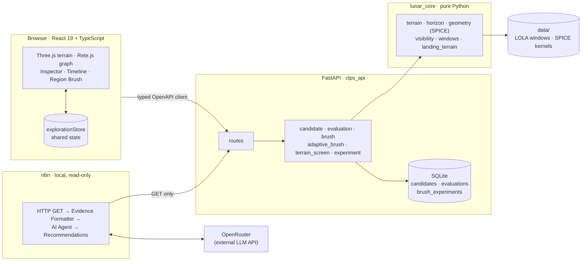

# LUNA-P/OPS

**A spatial–temporal parametric environment for exploring lunar south-pole landing-site candidates.
It is built on NASA LOLA terrain and NASA/NAIF SPICE geometry, keeps a provenance-tracked record of
every result, and adds an optional AI-assisted step that interprets the evidence.**

LUNA-P/OPS was developed for the **NASA Space Apps Challenge 2026** (*Lunar Landing Site
Navigator*). It extends the MIT-licensed
[CLPS Lunar Mission Browser](https://github.com/EmanuelAbasto/CLPS-Lunar-Mission-Browser) by
Emanuel Abasto (see [Credits](#credits-sources-and-license)). The original catalog comparison is
still included. The new work is a candidate workspace around one study area, **Shackleton Rim B**.

> **Scientific status.** Every stored result is labelled `COMPUTED_UNVERIFIED` (or `UNAVAILABLE`).
> Nothing in this repository has been independently validated as a landing-site, power or
> communications assessment. The terrain screen is coarse 20 m DEM screening, **not** certified
> landing safety. AI output is interpretation and proposal only. See
> [Verification and limitations](docs/VERIFICATION_AND_LIMITATIONS.md).



*The interface, captured on 2026-11-07 from the isolated test stack. It shows the Landing Graph,
the 4 km Shackleton Rim B terrain with two brush regions and their result markers, and the symbolic
sky dome with the stored horizon silhouette and Sun/Earth rays. The Inspector and the shared
Timeline follow, with the Region Brush dock below them.*

## Contents

1. [Purpose](#purpose)
2. [How it works](#how-it-works)
3. [Capabilities and status](#capabilities-and-status)
4. [Architecture at a glance](#architecture-at-a-glance)
5. [Quick start](#quick-start)
6. [Documentation map](#documentation-map)
7. [Contributions](#contributions)
8. [Principal limitations](#principal-limitations)
9. [Repository state](#repository-state)
10. [Credits, sources and license](#credits-sources-and-license)

## Purpose

Near the lunar south pole the Sun stays within a few degrees of the horizon, and the Earth is low
or below it. Local and distant terrain therefore decide whether a point sees the Sun or the Earth
at a given time. LUNA-P/OPS lets a researcher or designer:

- pick or sample candidate points directly on LOLA terrain;
- describe each candidate as an explicit set of parameters (location, terrain, observer height,
  time) in a node graph;
- evaluate Sun and Earth geometric visibility over a UTC interval, using one scientific engine;
- explore a region with a deterministic, evidence-driven sampling policy, optionally guided by a
  coarse DEM slope/roughness screen;
- store every result with enough provenance to reproduce it;
- optionally ask an AI model, through a local read-only n8n workflow, to review the stored
  evidence. The model points out limitations and missing evidence, and proposes next steps. It
  never runs anything.

It is a design and research environment. It does **not** rank landing sites for flight use.

## How it works



1. **Data.** Bounded windows of the LOLA south-pole DEMs, and the NAIF generic kernels, are
   downloaded once and hashed.
2. **Computation (Python only).** For each candidate the backend computes:
   - a 720-azimuth terrain horizon out to 200 km on the 1737.4 km reference sphere;
   - apparent Sun and Earth positions with SPICE;
   - sampled visibility (Sun upper limb, Earth centre) and visibility intervals.
3. **Candidates.** A terrain click creates an immutable **C0** (location, DEM elevation, observer
   height, time). **C1** revisions change the observer height or the time. Identity is a SHA-256
   of the scientific inputs.
4. **Adaptive exploration.** The **Region Brush** turns a polygon into a batch of candidates,
   chosen either on a uniform grid or by a deterministic policy driven by the computed evidence.
   Optional terrain limits screen locations. Results carry verdicts, Pareto flags and lineage.
5. **Evidence.** Evaluations, brush experiments and terrain screens are stored or reported with
   dataset and kernel hashes, software versions and the commit. Any stored evaluation can be
   exported as a manifest, or recomputed and compared without being stored.
6. **AI interpretation.** A local n8n workflow reads stored records through `GET` requests only. It
   builds a compact evidence pack and asks an OpenRouter model for a structured review, then
   checks the cited ids and numbers against the pack.

## Capabilities and status

Status key: **Tested** = implemented and covered by automated tests. **Experimental** =
implemented and tested, but its scientific value is shown only in bounded comparisons.
**Verified run** = demonstrated by a recorded execution. **Proposed** = not implemented.

| Area | What is implemented | Status |
| --- | --- | --- |
| Terrain workspace | Three.js view of Shackleton Rim B at two scales: **Regional · 40 km** (240 m DEM, 250 m display grid, contains the south pole) and **Scientific detail · 4 km** (20 m DEM, 20 m grid). Hover readout, compass, exaggeration, optional lighting from the stored Sun direction. | Tested |
| Candidates C0/C1 | A click inside the 4 km study area creates a C0 whose elevation is re-sampled from the 20 m DEM. C1 revisions change the observer height or time. Content-hash identity, append-only storage. | Tested |
| Landing Graph | Rete.js dataflow: Location, Terrain, Observer Height, Time → Candidate → Scientific computation → Results, plus a **Terrain screen** node on the same `candidate_ref`. Computation runs only on an explicit **Evaluate**. | Tested |
| Sun/Earth evaluation | Strict DEM coverage check, so a gap gives `UNAVAILABLE` and never a flat horizon. Horizon (0.5°, 200 km), SPICE `azlcpo` with `LT+S`, visibility rules, intervals, full provenance. | Tested; SPICE geometry compared with JPL Horizons |
| Timeline and Inspector | One shared state drives the Timeline cursor, the 3D sky geometry, the graph Results node and the Inspector. The cursor only moves between stored samples. | Tested |
| Region Brush | Several regions, read-only preview, confirmed execution, PASS/FAIL/NOT_ASSESSED/UNAVAILABLE/ERROR markers, C0 reuse, JSON export, region definitions restored after reload. | Tested |
| Adaptive refinement | `spatial-lattice-evidence-v1` (Experiment A, visibility evidence) and `spatial-lattice-evidence-terrain-v1` (Experiment B, plus terrain evidence). Farthest-point seeds, difference-guided midpoints, periodic exploration, one reserved temporal refinement, explicit reasons and parent IDs. | Experimental |
| Terrain screening | Horn local slope, neighbourhood plane slope, detrended RMS roughness and relief, DEM coverage, configurable limits → PASS/FAIL/NOT_ASSESSED. Sub-resolution hazards and DEM uncertainty are always `NOT_ASSESSED`. | Experimental |
| Pareto comparison | Non-dominated PASS results across the five sampled visibility metrics, plus slope and roughness when terrain limits are set. | Tested |
| Reproducibility | Experiment manifest export, **Recompute & compare** (never stores), content-addressed brush experiment snapshots. | Tested |
| AI review (n8n + OpenRouter) | Local n8n 2.38.7. Read-only retrieval of candidates, evaluations and manifests; evidence formatter; AI Agent with structured output; post-checks of ids, numbers and terrain claims. | Verified run (2026-11-08, manual trigger; webhook with the real model not demonstrated) |
| Catalog comparison | The original CLPS browser: compare 2–4 catalog or custom sites with sky diagrams, timelines, CSV/PNG export and a pole map. Catalog sites are **placeholders**, not official CLPS sites. | Tested (upstream) |
| Independent validation | Comparison with published illumination or horizon products at the Shackleton Rim B points. | Proposed |

## Architecture at a glance



- **Python is the only scientific authority.** Every elevation, horizon, position, visibility flag
  and terrain metric comes from `lunar_core` through the API. The browser and n8n never compute a
  physical quantity.
- **The frontend keeps one shared state** (`frontend/web/src/lib/explorationStore.ts`).
- **Persistence is append-only SQLite**, keyed by content hashes.
- **n8n orchestrates and interprets only.** Its HTTP nodes make `GET` requests, and its AI Agent
  has no tools.

Details: [docs/ARCHITECTURE.md](docs/ARCHITECTURE.md).

## Quick start

**Requirements:** Docker with Compose v2.20 or newer. Host Node.js and Chrome or Edge are needed
only for browser tests.

```bash
git clone https://github.com/ramesys/LUNAR-OPS.git
```

```bash
cd LUNAR-OPS
```

```bash
make up
```

`make up` builds the images and runs the one-shot `data` service, which downloads the SPICE
kernels, the catalog-site LOLA windows and the pole-map relief. It then starts the API and the web
app. **It does not download the Shackleton Rim B windows** used by the main workspace. Run this
once, then reload the page:

```bash
docker compose run --rm --no-deps api python -m clps_pipelines.fetch_roi
```

| Service | URL |
| --- | --- |
| Web app | http://localhost:5180 |
| API health | http://localhost:8000/api/health |
| API docs (Swagger UI) | http://localhost:8000/docs |

`make up` bakes the current Git commit (with `-dirty` for uncommitted changes) into the API image,
so new evaluations record it. Rebuild with `make up` after pulling or editing backend code: an
older image keeps serving the older API. Stop the stack with `docker compose stop`. Data lives in
the `data/` bind mount; never run `docker compose down -v` on a machine whose candidates you want
to keep.

**Optional AI review:**

```bash
make n8n-up
```

Open http://localhost:5678, create the local n8n owner account, then set the OpenRouter credential
and model in the **OpenRouter Chat Model** node. Full setup:
[docs/AI_N8N_INTEGRATION.md](docs/AI_N8N_INTEGRATION.md#9-setup-and-operation).

## Documentation map

| Document | Content |
| --- | --- |
| [docs/ARCHITECTURE.md](docs/ARCHITECTURE.md) | Layers, modules, API contract (read/write), frontend state, persistence, provenance, Docker stacks, dependencies |
| [docs/SCIENTIFIC_METHODOLOGY.md](docs/SCIENTIFIC_METHODOLOGY.md) | Datasets, coordinate systems, equations, horizon, ephemerides, visibility, temporal metrics, terrain screening, end-to-end method, references |
| [docs/ADAPTIVE_EXPLORATION.md](docs/ADAPTIVE_EXPLORATION.md) | C0/C1 model, Landing Graph, Timeline, Region Brush, refinement policies, terrain integration, Pareto, lineage, controlled comparisons |
| [docs/AI_N8N_INTEGRATION.md](docs/AI_N8N_INTEGRATION.md) | n8n deployment, node-by-node workflow, evidence pack, AI instructions, structured output, validation, case study of the verified run |
| [docs/VERIFICATION_AND_LIMITATIONS.md](docs/VERIFICATION_AND_LIMITATIONS.md) | Verification levels, test inventory and recorded results, reproducibility, data integrity, known issues |
| [docs/TERRAIN_AWARE_BRUSH_COMPARISON.md](docs/TERRAIN_AWARE_BRUSH_COMPARISON.md) · [docs/ADAPTIVE_BRUSH_CONTROLLED_COMPARISON.md](docs/ADAPTIVE_BRUSH_CONTROLLED_COMPARISON.md) | Experiment reports (controlled comparisons) |
| [docs/STATUS.md](docs/STATUS.md) | Dated development and handover log; the `LUNAR_OPS_SPRINT_0*.md` and `LUNAR_OPS_SESSION_HANDOVER.md` reports are historical |
| [docs/adr/](docs/adr/README.md) | Architecture decision records from the upstream project (Spanish) |

## Contributions

LUNA-P/OPS builds on established methods: terrain-horizon illumination analysis with LOLA
topography, and SPICE ephemerides. It does not claim a new illumination model. Its contributions
are in how these are combined and controlled:

1. **A parametric, provenance-first candidate model.** Each candidate is an immutable,
   content-addressed set of inputs (C0) with explicit revisions (C1). Evaluations, terrain screens
   and brush experiments are content-addressed too, so every displayed number traces back to
   hashed data, kernels and code.
2. **Strict data coverage.** A missing DEM sample along any horizon ray makes a result
   `UNAVAILABLE`. A flat horizon is never substituted.
3. **Deterministic, evidence-driven exploration.** The Region Brush selects locations from
   computed evidence only (verdict differences, metric differences, constraint margins, horizon
   proximity and, optionally, terrain margins). Every attempt records its reason and parent IDs.
4. **A controlled terrain-aware comparison.** For one region and budget, it measures how much
   terrain evidence changes where the visibility engine is spent
   ([report](docs/TERRAIN_AWARE_BRUSH_COMPARISON.md)).
5. **A constrained AI interpretation layer.** The AI receives only labelled stored evidence, must
   cite ids from it, cannot execute anything, and its output is checked automatically against that
   evidence ([docs](docs/AI_N8N_INTEGRATION.md)).

## Principal limitations

- **Not validated.** No result has been compared against an independent illumination or
  visibility product at the Shackleton Rim B points.
- **Geometric visibility only.** A Sun fraction is not power production, and Earth visibility is
  not link performance.
- **Coarse terrain screen.** It uses a 20 m interpolated DEM, so features below about 40 m, rocks
  and DEM uncertainty are not assessed. No lander footprint is modelled.
- **Discrete sampling.** Azimuths are sampled at 0.5°, radial distance at 20 m / 240 m, and time
  at the chosen step. Transitions are uncertain by up to one step.
- **Earth centre, Sun upper limb.** The Earth's ~1° disc is reduced to its centre.
- **AI output can be wrong.** In the verified run the model miscounted one category even though
  every number it cited existed in the evidence. A person must review its output.

Full list: [docs/VERIFICATION_AND_LIMITATIONS.md](docs/VERIFICATION_AND_LIMITATIONS.md#6-known-issues-and-limitations).

## Repository state

This documentation describes branch `feat/terrain-aware-brush` as released on 2026-11-08. It
adds three commits on top of the adaptive Region Brush (`7cdbb8c`):

- Experiment B terrain screening: `lunar_core/landing_terrain.py`, `clps_api/terrain_screen.py`
  and related UI, tests and the A/B comparison record;
- the n8n integration under `infrastructure/n8n/`;
- this documentation.

The branch is proposed to `main` through a pull request. Until it is merged, the default branch
does not contain this work.

**Release check, executed on 2026-11-08 on the committed code** (isolated stack; the real
database was unchanged):
- 172 backend tests, plus `ruff`, the format check and `mypy`;
- 107 frontend unit tests, plus ESLint, `tsc` and the production build;
- 26 browser checks (Chrome, desktop and phone);
- an OpenAPI client regenerated byte-identical.

See [docs/VERIFICATION_AND_LIMITATIONS.md](docs/VERIFICATION_AND_LIMITATIONS.md).

**Before a demonstration**, rebuild the development stack with `make up`. An API container started
from an older image (for example `02c13f3`) lacks the terrain-screen and brush-experiment routes.

## Credits, sources and license

- **Upstream project:** [CLPS Lunar Mission Browser](https://github.com/EmanuelAbasto/CLPS-Lunar-Mission-Browser)
  by Emanuel Abasto, MIT license. Its catalog comparison, SPICE geometry, terrain-horizon method,
  JPL Horizons golden test and ADRs are the foundation of this repository.
- **NASA GSFC Planetary Geodesy Data Archive (PGDA):**
  - LOLA south-pole products `LDEM_80S_20MPP_ADJ`, `LDEM_60S_240MPP_ADJ`, `LDEM_80S_80MPP_ADJ_HILL`
    and `LPSR_80S_20MPP_ADJ`;
  - Barker et al. (2023), [doi:10.3847/PSJ/acf3e1](https://doi.org/10.3847/PSJ/acf3e1);
  - https://pgda.gsfc.nasa.gov/products/90
- **NASA/JPL NAIF** generic SPICE kernels (`de440s.bsp`, `moon_pa_de421_1900-2050.bpc`,
  `moon_080317.tf`, `pck00011.tpc`, `naif0012.tls`). https://naif.jpl.nasa.gov/pub/naif/generic_kernels/
- **NASA/JPL Horizons**, the reference for the geometry test. https://ssd.jpl.nasa.gov/horizons/
- **NASA Lunar Surface Data Book** (Shackleton Rim B coordinates, table A2.1-1), via NTRS.
- **n8n** (workflow automation, self-hosted) and **OpenRouter** (LLM API gateway). The model used
  in the verified run was `mistralai/mistral-large-4-0`.
- Full reference list: [docs/SCIENTIFIC_METHODOLOGY.md](docs/SCIENTIFIC_METHODOLOGY.md#references).

License: [MIT](LICENSE). The original copyright notice is retained.
