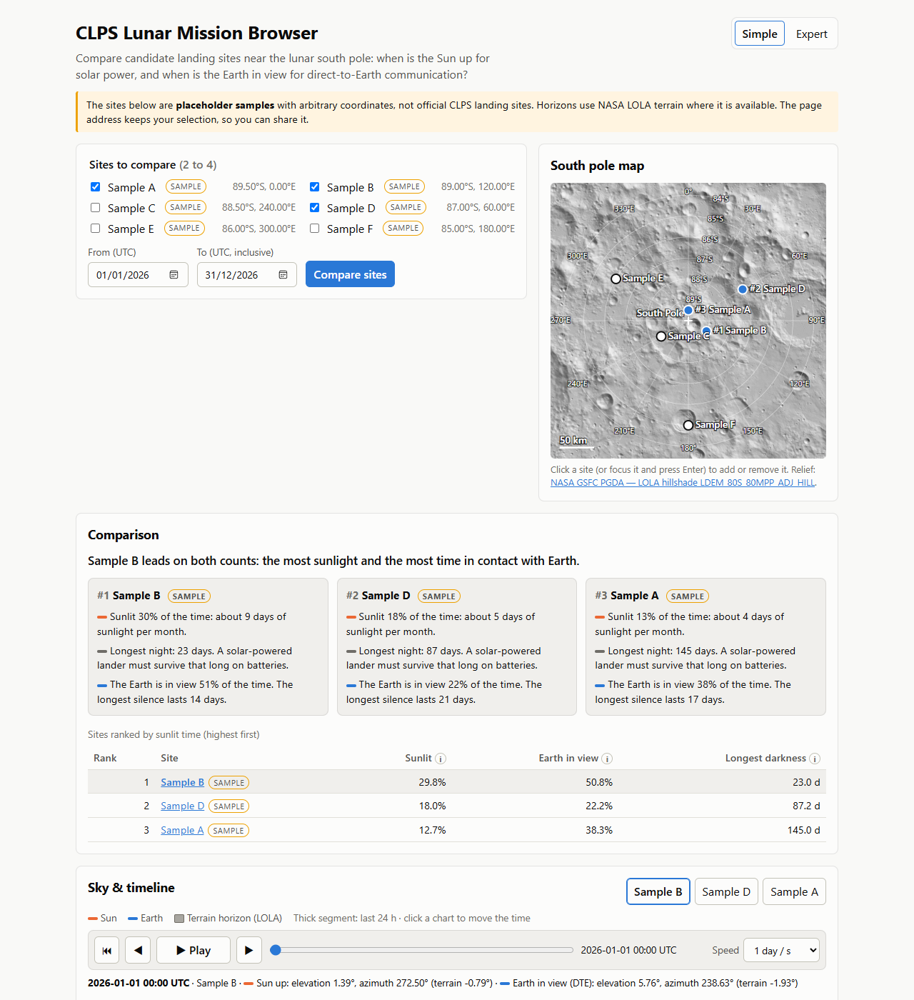
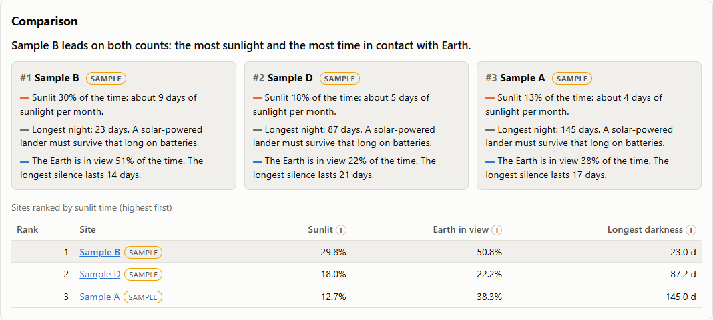
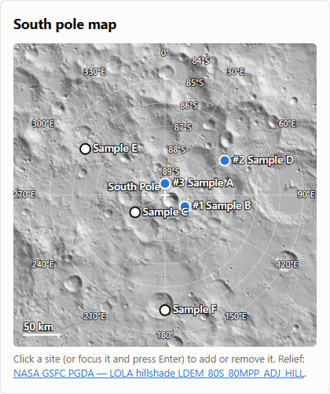
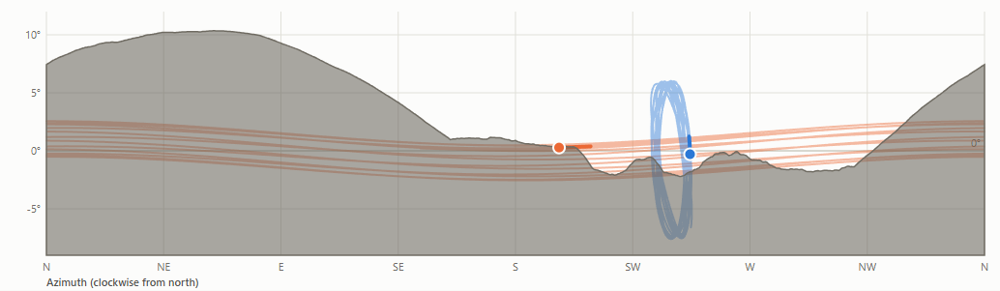
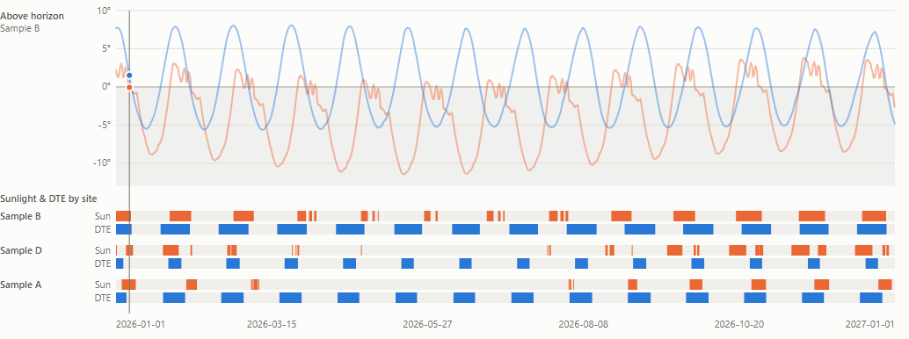
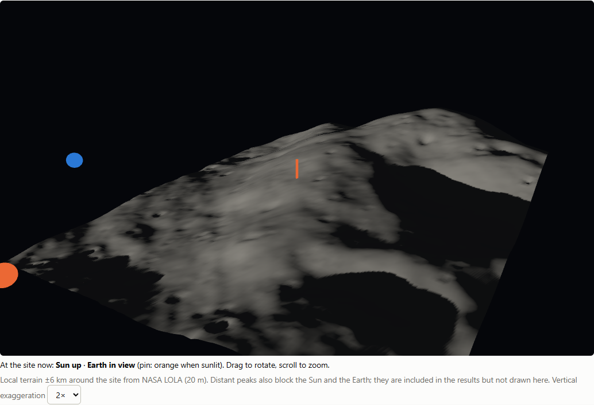
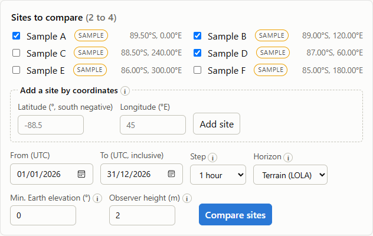
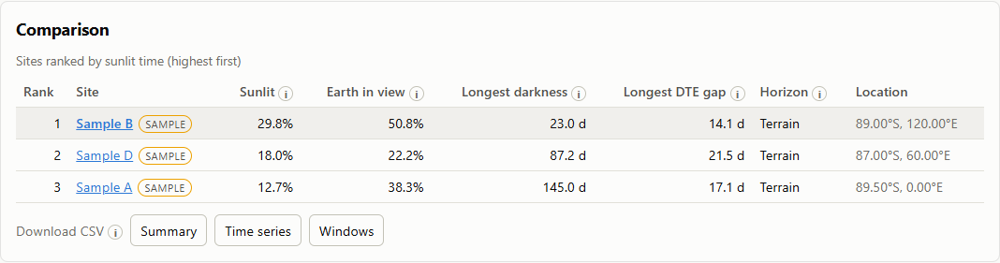
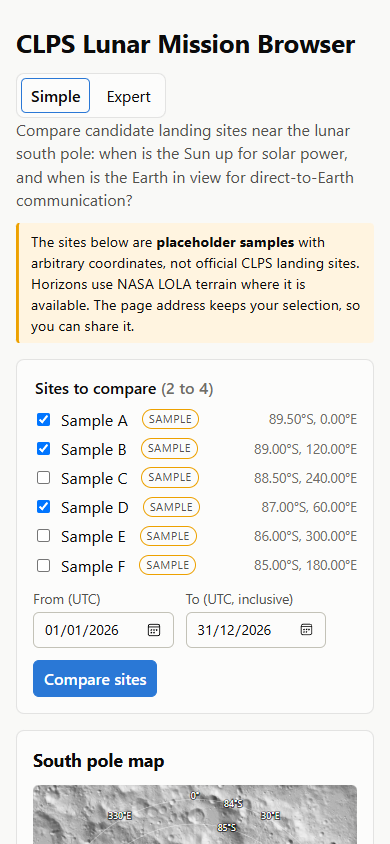
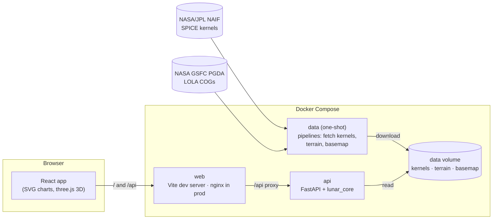

# CLPS Lunar Mission Browser

**Compare lunar south pole landing sites in seconds: when is the Sun up for solar power, and when is the Earth in view for direct‑to‑Earth (DTE) communication, over real NASA terrain.**

Built for the **NASA Space Apps Challenge 2026** (challenge #2, *CLPS Lunar Mission Browser*). Near the lunar south pole the Sun circles only a few degrees above the horizon and the Earth hangs low, so a single hill decides whether a lander has power or can talk to Earth. This app turns NASA/JPL ephemerides and NASA LOLA terrain into a comparison that mission planners, educators and the public can read at a glance.



The images below document an earlier catalog-focused interface; the current app also includes the Shackleton workspace, Landing Graph and candidate Inspector.

> **Sites are placeholders.** The catalog currently holds *sample* sites with arbitrary coordinates (clearly labeled in the UI). The official candidate sites are published with the full challenge statement; swapping them in is a one-file change (see [Updating the site catalog](#updating-the-site-catalog)).

## Contents

- [Features](#features)
- [Screenshots](#screenshots)
- [Quick start](#quick-start)
- [How it works](#how-it-works)
- [Architecture](#architecture)
- [Repository layout](#repository-layout)
- [Technology stack](#technology-stack)
- [API reference](#api-reference)
- [Development workflows](#development-workflows)
- [Deployment](#deployment)
- [Data sources and credits](#data-sources-and-credits)
- [Documentation](#documentation)
- [License](#license)

## Features

| | |
|---|---|
| **Compare 2–4 sites** | Pick sites from a list or on a south pole map drawn on NASA's LOLA relief, or add your own by latitude/longitude. Choose any UTC date range up to one year. |
| **Ranking and metrics** | Share of time in sunlight and with the Earth in view, the longest darkness (what batteries must survive) and the longest communication gap, ranked by sunlight. |
| **Real terrain** | Each catalog site's horizon is computed from LOLA elevation models out to 200 km. It can be switched to a flat horizon to see how much the terrain matters (it often flips the ranking). |
| **Sky diagram** | Azimuth/elevation paths of the Sun and the Earth over the site's terrain silhouette. |
| **Timeline** | Height above the local horizon over time, plus sunlight and DTE bands for every site. |
| **Animated time control** | Play, pause, step and scrub; both charts, the text readout and the 3D view stay in sync. |
| **3D view** | ±6 km of LOLA terrain around the site, lit and shadowed by the Sun at the time shown, with Sun and Earth markers. |
| **Simple / Expert modes** | Simple mode shows plain-language cards ("about 9 days of sunlight per month", "batteries must survive 23 days") and explanations. Expert mode exposes every setting: sampling step, horizon model, observer height, minimum Earth elevation for DTE. |
| **Exports** | CSV (summary, full time series, visibility windows) and self-contained PNG images of the charts. |
| **Shareable links** | The URL encodes the whole scenario, including custom sites and the mode. |
| **Transparency** | An assumptions and sources panel, a glossary and info tooltips. Results always state which horizon model was used. |

## Screenshots

| Plain-language results (Simple mode) | South pole map (LOLA relief) |
|---|---|
|  |  |

| Sky diagram over the terrain silhouette | Timeline with sunlight and DTE bands |
|---|---|
|  |  |

| 3D terrain lit by the Sun | Expert settings |
|---|---|
|  |  |

| Expert comparison with CSV export | Phone layout |
|---|---|
|  |  |

These are historical screenshots and do not show the current workspace. `make screenshots` overwrites the README images; start the isolated test stack with `make e2e-up` first and review generated images before committing them.

## Quick start

**Requirements:** Docker with Compose v2.20 or newer (Docker Desktop on Windows/macOS, or Docker Engine on Linux). Nothing else is needed on the host.

```sh
git clone git@github.com:EmanuelAbasto/CLPS-Lunar-Mission-Browser.git
cd CLPS-Lunar-Mission-Browser
docker compose up --build
```

On the first start, a one-shot `data` service downloads about **111 MB** into `data/`: SPICE kernels (35 MB), LOLA terrain windows for each catalog site, and the pole map relief. On a clean machine this takes about two minutes including the image builds. Later starts reuse the data.

| Service | URL |
|---|---|
| Web app | http://localhost:5180 |
| API | http://localhost:8000/api/health |
| API docs (Swagger UI) | http://localhost:8000/docs |

If the terrain or relief download fails (for example, offline), the app still works with a flat horizon, or without the map relief, and says so in the UI. The SPICE kernels are the only required download.

## How it works

### Geometry: where are the Sun and the Earth?

- **SPICE:** positions come from [SPICE](https://naif.jpl.nasa.gov/naif/) via `spiceypy`, using NASA/JPL NAIF generic kernels:
  - `de440s.bsp` (planetary ephemeris);
  - `moon_pa_de421_1900-2050.bpc` and `moon_080317.tf` (lunar orientation and the `MOON_ME` frame);
  - `pck00011.tpc` (lunar radius);
  - `naif0012.tls` (leap seconds).
- **Observer:** a point on the 1737.4 km lunar sphere, raised by a configurable observer height.
- **Apparent positions:** `azlcpo` returns them with light-time and stellar aberration corrections (`LT+S`), azimuth clockwise from local north, and no refraction (the Moon is airless).
- **Frame:** `MOON_ME` from DE421 is deliberate: it is the frame the LOLA terrain models are referenced to, so the geometry and the terrain line up without any transformation.

### Visibility rules

- **Sunlight:** the Sun counts as visible while its **upper limb** is above the horizon, i.e. elevation + apparent semidiameter > horizon. This matches JPL Horizons' "daylight" definition.
- **Direct-to-Earth:** the Earth's center must be above the horizon plus an optional minimum clearance (0–10°).
- **Horizon:** 0° for a flat horizon, or the terrain horizon mask in the body's direction.
- **Windows:** consecutive samples with the same state form visibility windows, with ±1 sampling step precision. Windows touching the edges of the date range are marked as truncated and shown as "≥".
- **Ranking:** by share of time in sunlight.

### Terrain horizons

For each catalog site the app computes a **horizon mask**: the highest terrain elevation angle every 0.5° of azimuth. It uses nested LOLA grids, following the method of Barker et al. (2023):

- 20 m/px within 8 km of the site, from `LDEM_80S_20MPP_ADJ`;
- 240 m/px out to 200 km, from `LDEM_60S_240MPP_ADJ`.

Rays follow great circles and include the exact curvature drop of the Moon. The pipeline only downloads the windows it needs; the cloud-optimized GeoTIFFs are read with HTTP range requests. A mask takes about 0.1 s on CPU and is cached per (site, observer height).

### Validation

| Check | Result |
|---|---|
| Sun and Earth azimuth/elevation vs. **JPL Horizons** (4 test points, polar and equatorial, one year daily, 2,928 samples) | Max error **0.05 arcsec** (test tolerance 1″) |
| Upper-limb sunlight rule vs. the Horizons daylight flag | Agrees on every sample (outside a 0.001° band around the threshold, well above the geometric error) |
| Terrain horizons vs. **NASA's LOLA permanently shadowed regions map** (50 random pixels, full 18.6-year lunar cycle) | **100 % agreement**: 25/25 shadowed pixels never lit, 25/25 lit pixels lit at some point |
| Map projection vs. `pyproj` using the DEM's own CRS | < 1 cm |

The Horizons reference data is stored in the repository, so the golden test runs offline. `make golden` refreshes it and `make spike-terrain` reruns the PSR validation.

### Assumptions and limitations

- The horizon mask is computed at a single point. Slopes and shadows across the lander footprint are not modeled.
- The 3D view draws ±6 km of terrain. Distant peaks that block the Sun or Earth are included in the results but not drawn; the view says so.
- Custom sites always use a flat horizon, because terrain is prepared only for catalog sites.
- A scenario is limited to one year and 10,000 samples (a full year at a 1-hour step fits).
- DE421 lunar orientation data covers 1900–2050.

## Architecture



- **`lunar_core`** is a pure Python library with no web code. It holds all domain logic: geometry, visibility rules, windows and metrics, terrain horizons, the pole map projection and the local terrain patch. The API and the data pipelines both use it.
- **The API** computes analyses **on demand**: a full year for four sites takes about 2–3 s cold, and responses are cached in memory and gzip-compressed. Calls into SPICE are serialized with a lock, because CSPICE is not thread-safe. OpenAPI types are generated into `frontend/api-client`, so the web app and the API share one typed contract.
- **The web app** never re-implements a physical rule. Charts, bands, CSV columns and plain-language texts are all derived from the API response.
- **Data** (kernels, terrain windows, relief image) is downloaded once by the `data` service into a volume. Nothing large is committed to git.

Design decisions and their rationale are recorded as [ADRs](docs/adr/README.md). The domain vocabulary (Site, Scenario, HorizonMask, VisibilityWindow…) is described in [docs/domain.md](docs/domain.md).

## Repository layout

```
.
├── backend/                     Python (uv workspace)
│   ├── lunar-core/              pure computation library (package: lunar_core)
│   │   ├── src/lunar_core/        geometry, visibility, windows, analysis, horizon, terrain, pole map, sites
│   │   └── tests/                 unit tests + JPL Horizons golden data
│   ├── api/                     FastAPI service (package: clps_api)
│   ├── pipelines/               data tasks: fetch kernels/terrain/basemap, Horizons golden data, terrain spike
│   ├── pyproject.toml           workspace, ruff, mypy, pytest configuration
│   └── uv.lock
├── frontend/                    TypeScript (pnpm workspace)
│   ├── web/                     React + Vite app (src/, unit tests, e2e/ Playwright tests)
│   ├── api-client/              OpenAPI schema + generated types + typed fetch client
│   ├── package.json · pnpm-workspace.yaml · pnpm-lock.yaml · tsconfig.base.json
├── infrastructure/              everything about running it
│   ├── docker-compose.yml       development stack (hot reload)
│   ├── docker-compose.prod.yml  production stack (nginx + API, one public port)
│   └── docker/                  api.Dockerfile, web.Dockerfile (dev/prod targets), nginx.conf, .dockerignore files
├── docs/
│   ├── adr/                     architecture decision records (Spanish) + English index
│   ├── domain.md                domain model and ubiquitous language
│   └── screenshots/             README images (generated by `make screenshots`)
├── data/                        downloaded datasets (git-ignored)
├── compose.yaml                 root entry point: includes infrastructure/docker-compose.yml
├── Makefile                     developer shortcuts (all wrap docker compose)
└── LICENSE
```

## Technology stack

| Area | Technologies |
|---|---|
| Computation | Python 3.12, [spiceypy](https://github.com/AndrewAnnex/SpiceyPy) (CSPICE N0067), NumPy, rasterio/GDAL (COG window reads), pyproj (projection checks) |
| API | FastAPI, Pydantic v2, Uvicorn, OpenAPI |
| Frontend | React 19, TypeScript 5.9 (strict, no `any`), Vite, hand-rolled SVG charts, three.js (3D, lazy-loaded), openapi-typescript + openapi-fetch |
| Quality | pytest, ruff, mypy `--strict`, Vitest + Testing Library, ESLint (`strictTypeChecked`, explicit types), Playwright end-to-end tests (system Microsoft Edge) |
| Infrastructure | Docker (multi-stage dev/prod images), Docker Compose (watch mode, healthchecks, one-shot data service), nginx |
| Package managers | uv (Python), pnpm (TypeScript) |

## API reference

Interactive documentation: http://localhost:8000/docs (Swagger UI) and `/openapi.json`.

| Method and path | Purpose |
|---|---|
| `GET /api/health` | Service and library versions |
| `GET /api/sites` | Site catalog with terrain availability and map position |
| `GET /api/sites/custom?latitude=&longitude=` | Canonical custom site (latitude ≤ −60°) |
| `GET /api/sites/{id}` | Look up a catalog or custom site (`custom:{lat}:{lon}`) |
| `GET /api/sites/{id}/terrain` | Local ±6 km terrain patch for the 3D view (404 without terrain) |
| `POST /api/analysis` | Full scenario analysis: series, windows, metrics, ranking, assumptions, sources |
| `GET /api/map` | Pole map extent and graticule |
| `GET /api/map/hillshade.png` | LOLA relief image for the map |

Example:

```sh
curl -s -X POST http://localhost:8000/api/analysis -H "Content-Type: application/json" -d '{
  "site_ids": ["sample-a", "sample-b"],
  "start": "2026-01-01T00:00:00Z", "end": "2026-02-01T00:00:00Z",
  "step_minutes": 60, "observer_height_m": 2, "horizon": "terrain", "earth_min_clearance_deg": 0
}'
```

## Development workflows

All backend and frontend tasks run **inside the dev containers**, so the host only needs Docker. `make` is optional: each target is a one-line wrapper around `docker compose`, so you can read the [Makefile](Makefile) and run the command directly. On Windows, use Git Bash or WSL; install make with `winget install ezwinports.make`.

| Command | What it does |
|---|---|
| `make up` / `make down` | Start the dev stack in the background (waits until healthy) / stop it |
| `make dev` | Start with **hot reload** (`docker compose up --watch`: edits in `backend/` and `frontend/` sync into the containers) |
| `make logs` | Follow the logs |
| `make test` | Backend tests (pytest, including the Horizons golden test) and frontend unit tests (Vitest) |
| `make lint` | `ruff` + `mypy --strict` and ESLint + `tsc --noEmit` |
| `make fmt` | Format Python with ruff |
| `make e2e` | Start the isolated test stack and run Playwright (host: Node 22+, pnpm, installed Edge or `E2E_CHANNEL=chrome`) |
| `make e2e-up` / `make e2e-stop` | Start / stop the separate test stack on port 15180 |
| `make screenshots` | Overwrite README images in `docs/screenshots` using the isolated stack |
| `make openapi` / `make check-openapi` | Regenerate the TypeScript client from the API / fail if it is out of date |
| `make fetch-data` · `fetch-terrain` · `fetch-basemap` | Download kernels / LOLA terrain windows / map relief (idempotent) |
| `make golden` | Refresh the JPL Horizons reference data (network) |
| `make spike-terrain` | Rerun the terrain validation against NASA's PSR map |
| `make prod-up` / `prod-down` / `prod-logs` | Production stack (see [Deployment](#deployment)) |

### Working on the host (optional)

```sh
# Backend: from backend/ (uv installs Python 3.12 if needed)
cd backend && uv sync
uv run pytest && uv run ruff check . && uv run mypy
CLPS_DATA_DIR=../data uv run uvicorn clps_api.main:app --reload     # API on :8000

# Frontend: from frontend/
cd frontend && pnpm install
pnpm test && pnpm lint && pnpm typecheck
pnpm --filter @clps/web dev                                         # web on :5173, proxies /api to :8000
```

### Conventions

- **Strict typing everywhere:** TypeScript with `strict` and ESLint rules that forbid `any` and require explicit types; Python with `mypy --strict`.
- **The API contract is generated:** after changing API models, run `make openapi` and commit `frontend/api-client`. `make check-openapi` catches drift.
- **Language:** code, identifiers, commits and the UI are in English. ADRs are in Spanish.
- **One place for each rule:** physical rules live only in `lunar_core`. The web app derives everything from API responses.

### Updating the site catalog

The catalog lives in `backend/lunar-core/src/lunar_core/catalog/sites.json`, with `origin` set to `sample` or `official`. To load official sites:

1. Replace the entries (planetocentric latitude, east longitude, `origin: "official"`).
2. Run `make fetch-terrain fetch-basemap`. It downloads terrain for new sites, and a new map extent if the sites extend further from the pole.
3. Run `make screenshots` to refresh the README images.

## Deployment

The production stack serves the compiled frontend with **nginx**, which also reverse-proxies `/api` to the API, so there is a single origin and no CORS setup. Only one port is published; the API is reachable only on the internal Docker network.

```sh
# On any Linux server (or workstation) with Docker Compose v2.20+
git clone git@github.com:EmanuelAbasto/CLPS-Lunar-Mission-Browser.git
cd CLPS-Lunar-Mission-Browser
WEB_PORT=8080 docker compose -f infrastructure/docker-compose.prod.yml up -d --build --wait
# or: make prod-up
```

| | Development (`docker compose up`) | Production (`infrastructure/docker-compose.prod.yml`) |
|---|---|---|
| Web | Vite dev server on :5180 | nginx, static build, on `WEB_PORT` (default 8080) |
| API | `--reload`, dev dependencies, port 8000 published | runtime dependencies only, non-root user, internal only |
| Data | bind mount `./data` | named volume `clps-data` |
| Restart policy | none | `unless-stopped`, with healthchecks |

- **Resources:** images are about 962 MB (API) and 75 MB (web), and the data volume about 111 MB. The first start downloads the data (roughly 2–4 minutes including the build).
- **HTTPS:** put the published port behind your usual TLS terminator (Caddy, Traefik, a cloud load balancer). The API runs with `--proxy-headers`.
- **Updating:** `git pull && make prod-up`. Data is kept in the volume. `docker compose -f infrastructure/docker-compose.prod.yml down -v` also deletes it.
- **Browser tests:** `make e2e-up` mounts the scientific data read-only and uses a separate temporary SQLite database. The Playwright suite targets only this isolated stack, not a deployment or the normal development database. The temporary test database is discarded when the API container stops or is recreated.

## Data sources and credits

- **NASA/JPL NAIF**, generic SPICE kernels: `naif0012.tls`, `pck00011.tpc`, `moon_pa_de421_1900-2050.bpc`, `moon_080317.tf`, `de440s.bsp`. https://naif.jpl.nasa.gov/pub/naif/generic_kernels/
- **NASA GSFC Planetary Geodesy Data Archive**, LOLA south pole products (Barker et al. 2023, [doi:10.3847/PSJ/acf3e1](https://doi.org/10.3847/PSJ/acf3e1)): `LDEM_80S_20MPP_ADJ`, `LDEM_60S_240MPP_ADJ`, `LDEM_80S_80MPP_ADJ_HILL`, `LPSR_80S_20MPP_ADJ`. https://pgda.gsfc.nasa.gov/products/90
- **NASA/JPL Horizons**, used as the validation reference. https://ssd.jpl.nasa.gov/horizons/

Data sources are also cited inside the app, and in every exported image.

## Documentation

- [Architecture decision records](docs/adr/README.md): why each technical choice was made, with measurements.
- [Domain model](docs/domain.md): entities, invariants and where they live in the code.
- Swagger UI at `/docs` on a running API.

## License

[MIT](LICENSE)
