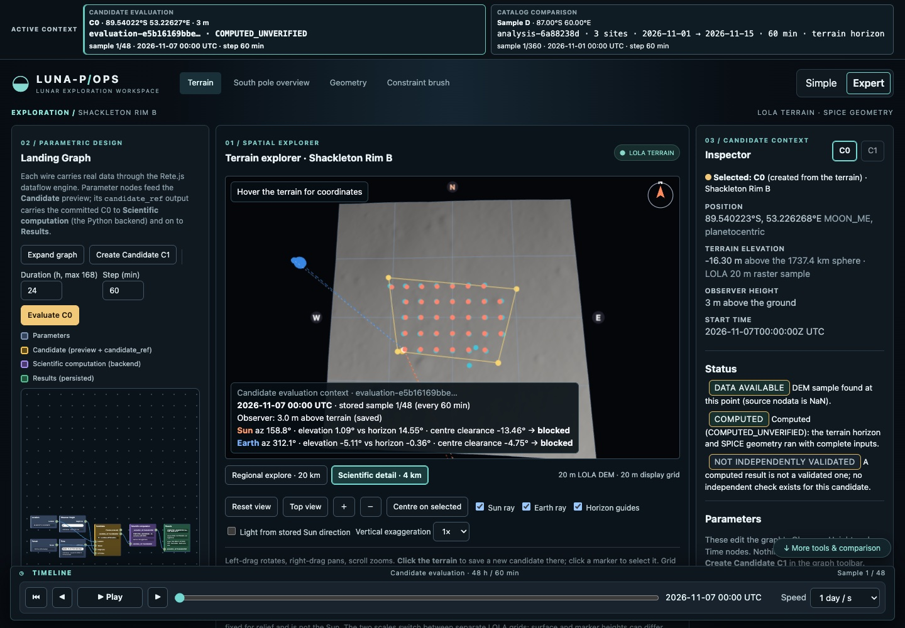
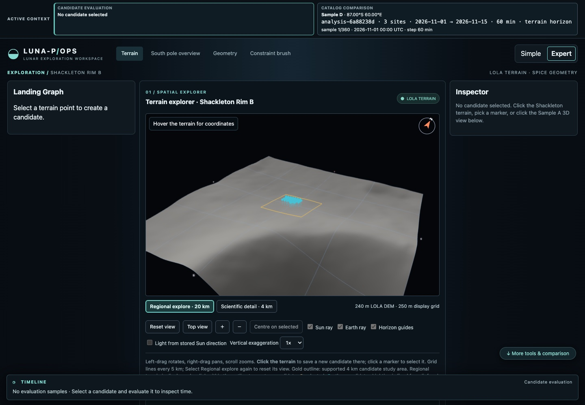
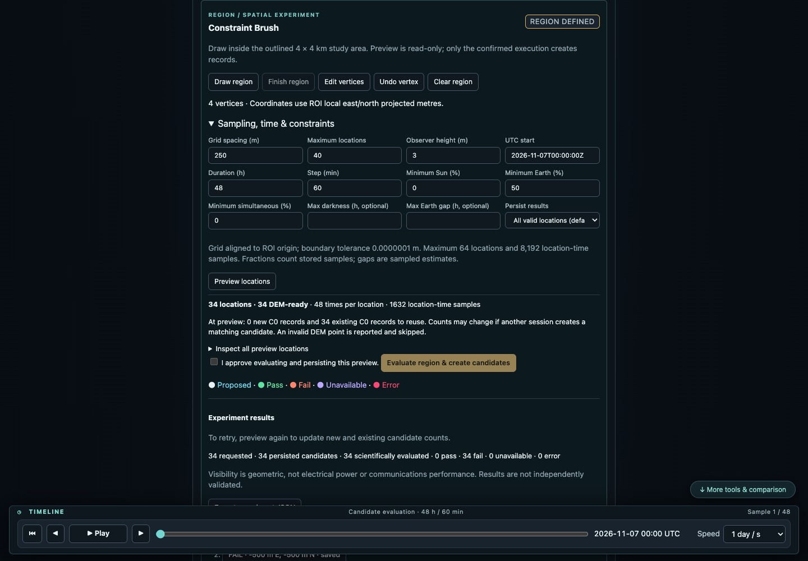
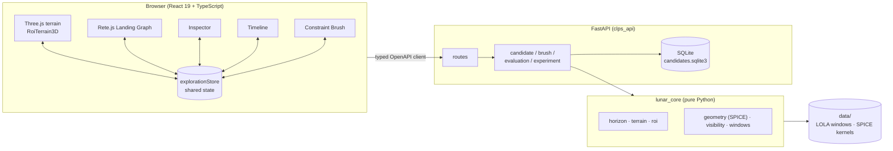

# LUNA-P/OPS

**A spatial–temporal parametric environment for exploring lunar south-pole landing-site candidates
on NASA LOLA terrain, with NASA/NAIF SPICE geometry and reproducible, provenance-tracked results.**

LUNA-P/OPS was developed for the NASA Space Apps Challenge 2026. It extends the MIT-licensed
[CLPS Lunar Mission Browser](https://github.com/EmanuelAbasto/CLPS-Lunar-Mission-Browser) by
Emanuel Abasto (see [Credits](#credits-sources-and-license)). The original catalog comparison is
still included; the new work is a candidate workspace around one study area, **Shackleton Rim B**.

> **Scientific status.** Every stored result is labelled `COMPUTED_UNVERIFIED` (or `UNAVAILABLE`).
> Nothing in this repository has been independently validated as a landing-site, power or
> communications assessment. See [Scientific limitations](#scientific-limitations).



*Current interface (captured 2026-11-07 from the isolated test stack): Landing Graph, 4 km
Shackleton Rim B terrain with Constraint Brush sample markers, Inspector and the shared Timeline.*

## Contents

1. [Purpose](#purpose)
2. [Implemented capabilities](#implemented-capabilities)
3. [Interface](#interface)
4. [Architecture](#architecture)
5. [Scientific data and calculation workflow](#scientific-data-and-calculation-workflow)
6. [Constraint Brush: region to candidates](#constraint-brush-region-to-candidates)
7. [Getting started](#getting-started)
8. [Development and testing](#development-and-testing)
9. [Persistence, backup and reproducibility](#persistence-backup-and-reproducibility)
10. [Scientific limitations](#scientific-limitations)
11. [Current development status](#current-development-status)
12. [Credits, sources and license](#credits-sources-and-license)

## Purpose

Near the lunar south pole the Sun stays within a few degrees of the horizon and the Earth is low
or below it, so local terrain decides whether a point sees the Sun or the Earth at a given time.
LUNA-P/OPS lets a researcher or designer:

- pick or sample candidate points directly on LOLA terrain;
- describe each candidate as an explicit set of parameters (location, terrain, observer height,
  time) in a node graph;
- evaluate Sun and Earth geometric visibility over a UTC interval with one scientific engine;
- inspect the result over time, and store it with enough provenance to reproduce it.

It is a design and research environment. It does not rank landing sites for flight use.

## Implemented capabilities

| Area | What is implemented |
| --- | --- |
| Terrain workspace | Three.js view of the Shackleton Rim B study area at two scales: **Regional explore · 20 km** (240 m LOLA DEM, 250 m display grid) and **Scientific detail · 4 km** (20 m LOLA DEM, 20 m display grid). Hover readout of position and elevation, compass, grid, vertical exaggeration, optional lighting from the stored Sun direction. |
| Candidates | Clicking inside the outlined 4 km study area creates an immutable **C0** candidate whose elevation is re-sampled from the original 20 m DEM (clicks outside it are refused). **C1** revisions (new observer height or time) are derived from a C0. Identity is a SHA-256 of the scientific inputs. |
| Landing Graph | Rete.js graph: Location, Terrain, Observer Height and Time nodes → Candidate → Scientific computation (backend) → Results. Computation runs only on an explicit **Evaluate**. |
| Evaluation | Per-candidate terrain horizon (0.5° azimuth, 200 km) from LOLA, Sun and Earth positions from SPICE, sampled visibility series and intervals, full provenance. Strict DEM coverage check: missing data gives `UNAVAILABLE`, never a flat-horizon substitute. |
| Timeline and Inspector | One shared state drives the Timeline cursor, the Sun/Earth rays and horizon guides in 3D, the graph Results node and the Inspector. The cursor only moves between stored samples; it never computes. |
| Constraint Brush | Polygon drawing and vertex editing on the 4 km terrain, deterministic grid sampling, read-only preview, confirmed batch evaluation, PASS/FAIL/UNAVAILABLE/ERROR markers, C0 persistence with reuse of matching candidates, experiment JSON export. |
| Reproducibility | Stored evaluations record dataset and kernel SHA-256 hashes, library versions and the software commit. An experiment manifest can be exported; **Recompute & compare** recomputes without storing and reports differences. |
| Catalog comparison | The original CLPS browser: compare 2–4 catalog or custom sites over a date range with sky diagrams, timelines, CSV/PNG export and a south-pole map. Catalog sites are **placeholders**, not official CLPS sites. |

## Interface

| Regional explore (20 km, 240 m DEM) | Constraint Brush panel after an evaluated run |
| --- | --- |
|  |  |

These three images were captured from the running application on the isolated test stack, whose
database is temporary. The results shown are real outputs (all points fail a 50 % Earth-visibility
constraint for 2026-11-07, 48 h). Older images in `docs/screenshots/` (`01-…` to `09-…` and the
`sprint0x-…` files) are **historical** and show earlier interfaces.

## Architecture



- **The backend is the only scientific authority.** All elevations, horizons, positions and
  visibility flags come from `lunar_core` through the API. The browser never re-implements a
  physical rule; 3D heights, exaggeration and rays are display only.
- **The frontend keeps one shared state** (`frontend/web/src/lib/explorationStore.ts`). Selection,
  revision, active evaluation, cursor and draft parameters each change only through named actions.
- **Persistence is append-only SQLite** for candidates and evaluations, keyed by content hashes.
- The TypeScript API client is generated from the FastAPI OpenAPI schema.

Details: [docs/ARCHITECTURE.md](docs/ARCHITECTURE.md).

## Scientific data and calculation workflow

| Input | Source | Use |
| --- | --- | --- |
| `LDEM_80S_20MPP_ADJ` (20 m/px) | NASA GSFC PGDA, LOLA south-pole DEM (Barker et al. 2023) | Candidate elevation, near-field horizon (≤ 8 km), 4 km display grid |
| `LDEM_60S_240MPP_ADJ` (240 m/px) | NASA GSFC PGDA | Far-field horizon (8–200 km), 20 km regional display grid |
| `de440s.bsp`, `moon_pa_de421_1900-2050.bpc`, `moon_080317.tf`, `pck00011.tpc`, `naif0012.tls` | NASA/JPL NAIF generic kernels | Sun and Earth positions in `MOON_ME`, lunar radius, leap seconds |

Only bounded windows of the DEMs are downloaded and cached as `.npz` files under `data/terrain/`.

Evaluation of one candidate (`backend/api/src/clps_api/evaluation.py`):

1. Check the candidate's stored dataset hash and elevation against the current 20 m window.
2. Check that every horizon ray sample (720 azimuths, 20 m steps to 8 km, 240 m steps to 200 km)
   has finite DEM data. Any gap → `UNAVAILABLE`.
3. Compute the terrain horizon mask on the 1737.4 km reference sphere, including curvature.
4. Compute apparent Sun and Earth azimuth/elevation with SPICE (`azlcpo`, `LT+S`, no refraction)
   at each sample time, for an observer at DEM elevation + observer height.
5. Sun visible ⇔ upper limb above the horizon mask; Earth visible ⇔ centre above the mask.
6. Build sampled series and visibility intervals; store with provenance as `COMPUTED_UNVERIFIED`.

Full method, coordinate conventions and verification levels:
[docs/SCIENTIFIC_METHODOLOGY.md](docs/SCIENTIFIC_METHODOLOGY.md).

## Constraint Brush: region to candidates

The Constraint Brush turns a drawn region into a batch of evaluated candidates.

1. **Draw** a polygon on the 4 km terrain (top view recommended); finish, then optionally edit or
   remove vertices. Vertices are stored as ROI-local east/north offsets in projected metres.
2. **Set parameters:** grid spacing (≥ 20 m), maximum locations (≤ 64), observer height, UTC start,
   duration (≤ 168 h), step, and constraints: minimum Sun, Earth and simultaneous fractions,
   optional maximum darkness and Earth gap. Choose whether to persist all valid locations or only
   passing ones.
3. **Preview** (read-only). The backend validates the polygon (≥ 3 vertices, no duplicate adjacent
   vertices, no self-intersection, non-zero area, inside the ROI), samples a grid aligned to the
   ROI origin, samples the DEM at each point and returns latitude/longitude, elevation, the
   candidate ID each point would have, whether it already exists, and a preview token. The total
   workload is limited to 8,192 location-time samples. Preview never writes to the database.
4. **Execute** after explicit confirmation. The backend recomputes the preview and refuses to run
   if the token changed. Each point is evaluated with the same engine as a single candidate.
   With "all valid locations" the C0 is saved before evaluation, so partial runs are traceable and
   retries reuse the same IDs.
5. **Verdicts:** `PASS`/`FAIL` (evaluated, constraints met or not), `UNAVAILABLE` (DEM or coverage
   missing), `ERROR` (unexpected failure). Markers on the terrain use the same colours.
6. **Inspect** any persisted result in the Landing Graph, Inspector and Timeline, or **export** the
   whole run (preview, per-point results, evaluations with provenance, notes) as JSON.

Fractions are counts of stored samples; gaps are sampled estimates and may differ from continuous
time by up to one step. The brush run itself is browser-session state: after a reload, the
persisted candidates remain, but the region and verdict list are recovered only from the exported
JSON.

## Getting started

**Requirements:** Docker with Compose v2.20 or newer. Host Node.js and a Chrome or Edge
installation are needed only for browser tests.

```bash
git clone https://github.com/ramesys/LUNAR-OPS.git
```

```bash
cd LUNAR-OPS
```

```bash
make up
```

`make up` builds the images, runs the one-shot `data` service and starts the API and web app. The
`data` service downloads the SPICE kernels (required), the LOLA windows for the catalog sites and
the pole-map relief. **It does not download the Shackleton Rim B windows** used by the main
workspace. Run this once after the first start, then reload the page:

```bash
docker compose run --rm --no-deps api python -m clps_pipelines.fetch_roi
```

| Service | URL |
| --- | --- |
| Web app | http://localhost:5180 |
| API health | http://localhost:8000/api/health |
| API docs (Swagger UI) | http://localhost:8000/docs |

`make up` passes the current Git commit (with `-dirty` for uncommitted changes) into the API image
so that new evaluations record it. Stop the stack with `docker compose stop`. Data lives in the
`data/` bind mount; never run `docker compose down -v` on a machine with candidates you want to
keep.

## Development and testing

All backend and frontend tasks run in the development containers. Useful targets
(see the [Makefile](Makefile)):

| Command | Purpose |
| --- | --- |
| `make up` / `make dev` / `make down` | Start (detached) / start with hot reload / stop the dev stack |
| `make lint` | `ruff`, `ruff format --check`, `mypy --strict`; ESLint and `tsc --noEmit` |
| `make test-web` | Vitest unit tests |
| `make openapi` / `make check-openapi` | Regenerate the TypeScript client / fail on contract drift |
| `make fetch-data` · `fetch-terrain` · `fetch-basemap` | Re-download kernels, catalog terrain, relief |
| `make e2e-up` / `make e2e-stop` | Start / stop the isolated browser-test stack on port 15180 |

**Backend tests with an isolated database.** `make test-py` mounts the real `data/` directory.
The tests use temporary directories for the database, but to rule out any write to real
candidates, run them with read-only scientific inputs and a throw-away `/data`:

```bash
docker run --rm --tmpfs /data -v "$PWD/backend:/workspace" -v "$PWD/data/kernels:/data/kernels:ro" -v "$PWD/data/terrain:/data/terrain:ro" -v "$PWD/data/basemap:/data/basemap:ro" clps-lunar-mission-browser-api:dev sh -c "ruff check . && ruff format --check . && mypy && pytest -q -p no:cacheprovider"
```

**Frontend checks and production build:**

```bash
docker compose run --rm --no-deps -T --build -v ./frontend/web/src:/workspace/web/src -v ./frontend/api-client/src:/workspace/api-client/src -v ./frontend/api-client/openapi.json:/workspace/api-client/openapi.json web sh -c "pnpm -r --workspace-root test && pnpm -r --workspace-root lint && pnpm -r --workspace-root typecheck && pnpm --filter @clps/web build"
```

**Browser tests** run only against the isolated stack: scientific data read-only, SQLite in
container `tmpfs`, and a guard file that makes the suite refuse any other server.

```bash
make e2e-up
```

```bash
cd frontend/web && E2E_CHANNEL=chrome ./node_modules/.bin/playwright test --project=desktop --project=phone
```

The host `node_modules` must exist (`pnpm install` in `frontend/`). `make e2e` does the same but
requires `pnpm` on the host. Do not run the `screenshots` project unless you intend to overwrite
the historical README images.

Conventions: strict typing (`mypy --strict`, TypeScript `strict`, no `any`); physical rules live
only in `lunar_core`; after changing API models run `make openapi` and commit
`frontend/api-client`. ADRs from the upstream project are in Spanish
([docs/adr](docs/adr/README.md)).

## Persistence, backup and reproducibility

- `data/candidates.sqlite3` holds two append-only tables, `candidates` and `evaluations`, each a
  JSON payload keyed by a content hash. Saving the same record twice is a no-op; a different
  payload under an existing ID is rejected as an identity collision.
- `data/` (database, kernels, DEM windows, relief) is git-ignored. Never commit it.
- **Backup:** stop the stack, then copy the database with SQLite's backup API, e.g.
  `sqlite3 data/candidates.sqlite3 ".backup '/path/outside/repo/candidates.sqlite3'"`, and check it
  with `PRAGMA integrity_check`. Keep SHA-256 hashes of the `data/terrain` and `data/kernels`
  files: candidate identity depends on the near-field DEM window hash, so a re-downloaded window
  with different bytes makes existing candidates fail their identity check (by design).
- **Reproduce** a stored evaluation from the Inspector: export the experiment manifest, or use
  Recompute & compare, which reruns the computation without storing it. Agreement shows
  repeatability with the same data and code, not scientific validation.
- Git remotes: work is published to the project repository (`ramesys/LUNAR-OPS`). The upstream
  `EmanuelAbasto/CLPS-Lunar-Mission-Browser` remote is for attribution and reference only; do not
  push to it.

## Scientific limitations

- **Not validated.** No result has been compared against an independent illumination or
  visibility product for the Shackleton Rim B points. See the verification levels in
  [docs/SCIENTIFIC_METHODOLOGY.md](docs/SCIENTIFIC_METHODOLOGY.md#8-verification-levels).
- **Geometric visibility only.** A Sun fraction is not power production; Earth visibility is not
  link performance; neither indicates landing safety (slope, rocks, hazards are not modelled).
- **Point model.** Each candidate is a single point; the lander footprint is not modelled.
- **Discrete sampling.** Horizon at 0.5° azimuth and finite radial steps; time at the chosen step.
  Results hold at the sample times only; transitions are uncertain by up to one step.
- **Earth centre, not disc.** Earth visibility tests the centre (its ~1° apparent radius is
  ignored); the Sun test uses the upper limb.
- **Spherical reference.** Elevations and geometry use the 1737.4 km LOLA reference sphere.
  DE421 lunar orientation covers 1900–2050.
- **3D view is not the scientific horizon.** The viewer shows at most a 20 km area; visibility
  comes from the stored 200 km horizon mask. Mesh heights, exaggeration and lighting are visual.
- **Separate terrain scales.** The 20 km and 4 km views are separate DEM meshes, switched rather
  than blended; their heights can differ at the same point.
- **Placeholders.** Catalog sites A–F are arbitrary samples. Shackleton Rim B (−89.5244°,
  56.30993°E, NASA Lunar Surface Data Book table A2.1-1) is a study-area centre, not a landing
  site; the 4 × 4 km square around it is a proposed study area.

## Current development status

Reviewed at commit `06bda7c` on 2026-11-07. Backend (148 tests), frontend unit (80), lint, type
checks, production build and 19 browser checks (Chrome, desktop and phone) passed in that review.
What works, what is unverified, the review findings and the recommended next milestone are in
[docs/STATUS.md](docs/STATUS.md). Sprint reports `docs/LUNAR_OPS_SPRINT_0*.md` and
`docs/LUNAR_OPS_SESSION_HANDOVER.md` are historical records.

Main known limitations: no 40 km regional view; no LROC imagery; no region-level executable graph
nodes; brush execution is synchronous without progress or cancel; the brush run is not persisted
as one record; the three.js chunk triggers a bundle-size warning.

## Credits, sources and license

- **Upstream project:** [CLPS Lunar Mission Browser](https://github.com/EmanuelAbasto/CLPS-Lunar-Mission-Browser)
  by Emanuel Abasto, MIT license. Its catalog comparison, SPICE geometry, terrain-horizon method,
  JPL Horizons golden test and ADRs are the foundation of this repository.
- **NASA GSFC Planetary Geodesy Data Archive**, LOLA south-pole products
  `LDEM_80S_20MPP_ADJ`, `LDEM_60S_240MPP_ADJ`, `LDEM_80S_80MPP_ADJ_HILL`, `LPSR_80S_20MPP_ADJ`
  (Barker et al. 2023, [doi:10.3847/PSJ/acf3e1](https://doi.org/10.3847/PSJ/acf3e1)).
  https://pgda.gsfc.nasa.gov/products/90
- **NASA/JPL NAIF** generic SPICE kernels. https://naif.jpl.nasa.gov/pub/naif/generic_kernels/
- **NASA/JPL Horizons**, used as the reference for the upstream geometry test.
  https://ssd.jpl.nasa.gov/horizons/
- **NASA Lunar Surface Data Book** (Shackleton Rim B coordinates), via NTRS.

License: [MIT](LICENSE). The original copyright notice is retained.
