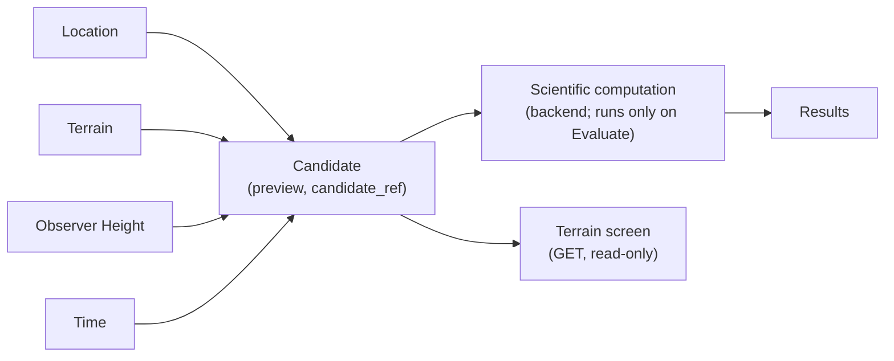
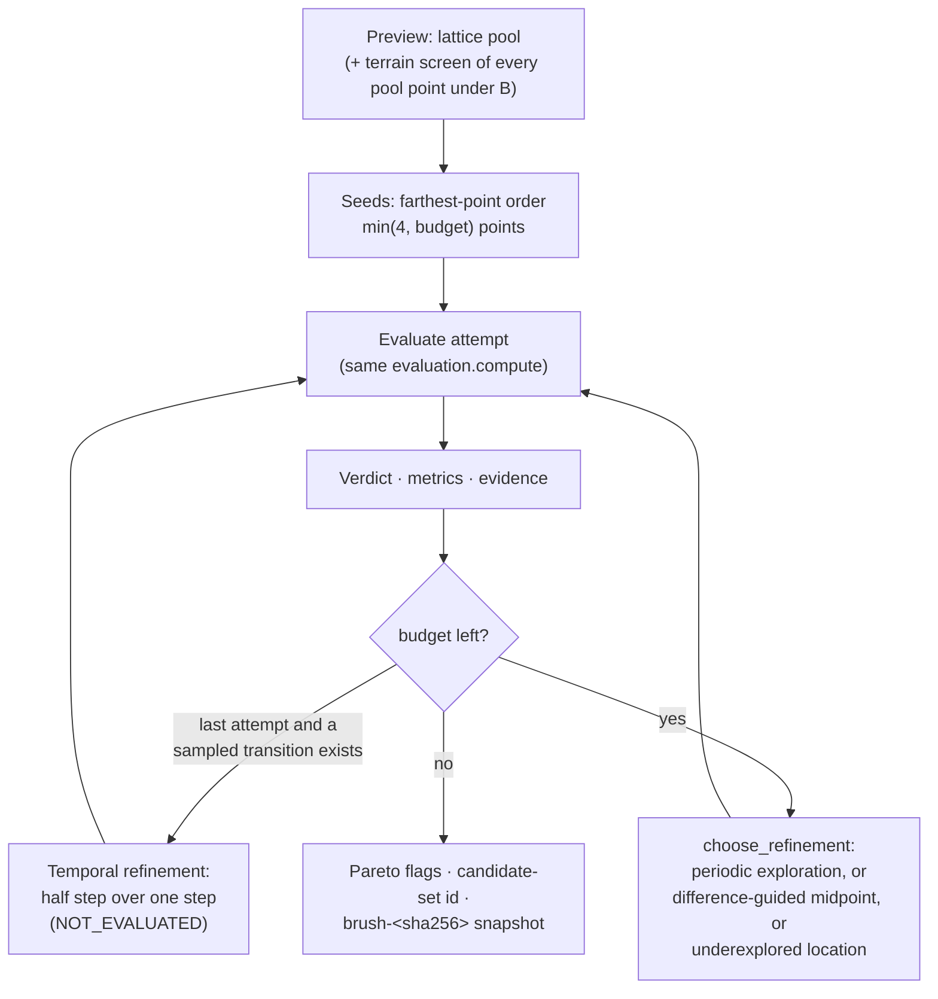

# Parametric and adaptive exploration

Status: describes the release state of branch `feat/terrain-aware-brush`, including terrain
screening and Experiment B on top of the adaptive Region Brush (`7cdbb8c`), reviewed on 2026-11-08. Scientific definitions of the
metrics are in [SCIENTIFIC_METHODOLOGY.md](SCIENTIFIC_METHODOLOGY.md). Source files:
`backend/api/src/clps_api/brush.py`, `adaptive_brush.py`, `brush_store.py`, `terrain_screen.py`,
`frontend/web/src/components/ConstraintBrush.tsx`, `LandingGraph.tsx`, `RegionLineage.tsx`.

All results produced by these tools are `COMPUTED_UNVERIFIED`. The adaptive policies are
**experimental**: they are deterministic and tested, but their benefit has only been shown in
bounded, controlled comparisons (§8).

## 1. The parametric candidate model

A **candidate** is the complete, explicit set of inputs of one scientific computation.

| Level | Created by | Parameters | Identity |
| --- | --- | --- | --- |
| **C0** (root) | A click inside the 4 km study area on the *Scientific detail* view; `POST /api/rois/{roi_id}/candidates`; or a Region Brush execution | ROI-local east/north offset → latitude/longitude, DEM elevation re-sampled from the 20 m window, DEM hash and source, observer height, start time | SHA-256 of all of these |
| **C1** (revision) | **Create Candidate C1** in the Landing Graph; `POST /api/candidates/{id}/evolve` | parent C0, new observer height and/or time | SHA-256 of parent, height, time |

- Candidates are immutable and append-only. Re-creating the same inputs returns the same record.
- Clicks outside the study area, on the 40 km regional view, or while a region evaluation runs
  never create candidates.
- An **evaluation** binds a candidate to a request (duration ≤ 168 h, step 1–360 min) and stores
  the full result with provenance. One candidate can have several evaluations.

### 1.1 Landing Graph (Rete.js)

- The graph is a view of the candidate's parameters. It is not a second engine: the Scientific
  computation node calls the backend, is memoised, and runs only on an explicit **Evaluate**.
- The **Terrain screen** node uses the same `candidate_ref`. Its limits come from the
  inspected region, or from defaults. It issues a GET and never stores anything.
- There are no region-level graph nodes. A region's lineage is shown next to the graph by
  `RegionLineage` (§6).

### 1.2 Timeline, Inspector and the 3D sky

One shared store (`frontend/web/src/lib/explorationStore.ts`) drives several views:

- the Timeline cursor;
- the Inspector;
- the graph Results node;
- the 3D Sun/Earth geometry: paths, trail, cursor ray, stored horizon silhouette, clearance arc.

The cursor moves only between stored samples, so nothing is computed or interpolated in the
browser. The sky is drawn on a symbolic dome (2.6 km radius at 4 km, 12 km at 40 km): directions
are real, distances are not.

## 2. Region Brush workflow

The Region Brush dock sits directly below the Timeline. It turns a drawn region into a batch of
evaluated candidates.

1. **Draw.** Choose **＋ New region** and click the terrain inside the 4 km study area (Scientific
   detail and top view are recommended). Then choose **Finish region**, and optionally edit, undo
   or remove vertices.
   - Vertices are ROI-local east/north offsets in projected metres.
   - Several regions can exist, and chips select one.
   - **Delete region** asks for confirmation and removes only the drawing. Persisted candidates
     and evaluations are kept.
2. **Set parameters.**
   - Lattice and budget: spacing (≥ 20 m), maximum attempts (≤ 64), observer height.
   - Time: UTC start, duration (≤ 168 h), step (1–360 min).
   - Constraints: minimum Sun, Earth and simultaneous fractions; optional maximum darkness and
     maximum Earth gap.
   - Retention: persist all valid locations, or only passing ones.
   - Sampling: **grid** or **adaptive**.
   - Optional terrain limits: local slope, plane slope, RMS roughness, relief, minimum DEM
     coverage, neighbourhood radius.
   - Refinement evidence: **A** (visibility) or **B** (visibility + terrain; needs adaptive
     sampling and terrain limits).
3. **Preview** (read-only). The backend validates the polygon: 3–64 vertices within ±2000 m, no
   duplicate adjacent vertices, no self-intersection, non-zero area. It then:
   - samples the lattice and, in adaptive mode, chooses the seeds;
   - screens terrain if limits are set;
   - samples the DEM at each point and returns its coordinates, elevation, prospective candidate
     ID and existence flag;
   - returns a **preview token**, the SHA-256 of the definition and samples.

   The worst-case workload is limited to 8,192 location-time samples. Preview opens the database
   read-only and never creates it.
4. **Execute** after explicit confirmation (`confirmed: true` plus the token). The backend
   recomputes the preview and refuses to run if the token changed. Each attempt is evaluated with
   the same `evaluation.compute` as a single candidate. With *all valid locations*, the C0 is saved
   before evaluation, so partial runs are traceable and retries reuse the same IDs.
5. **Verdicts** (§5) are shown as markers in the same colours as the result list.
6. **Inspect** any persisted result in the Landing Graph, Inspector and Timeline, or **export** the
   whole run as JSON: preview, per-point results, evaluations with provenance, and notes.

**Session behaviour.**
- Region definitions (vertices and parameters) are kept in `localStorage`
  (`lunar-ops-regions`) and restored after a reload.
- A region's preview and verdict list are session state. After a reload, persisted candidates and
  evaluations remain in SQLite. Completed **adaptive** runs can also be reopened from their stored
  snapshot (§6); grid runs are recovered only from the exported JSON.
- Editing a region discards its preview and results view. A response that returns after its
  region was edited or deleted is dropped.
- Execution is one synchronous request, with no progress indicator or cancel.

## 3. Grid and adaptive sampling

The lattice consists of the points at integer multiples of the spacing in ROI-local east/north,
aligned to the ROI origin, inside the polygon. Points on an edge or vertex count as inside
(tolerance 1e-7 m).

- **Grid** evaluates the first `max_points` lattice points, ordered south to north and west to
  east.
- **Adaptive** uses the whole lattice as a *pool*. It evaluates up to four seeds, then proposes one
  location at a time from the evidence already computed, until the attempt budget (`max_points`)
  is used or nothing eligible remains.

## 4. Refinement policies

Two policies exist. Both are deterministic, so the same inputs give the same sequence:

- `spatial-lattice-evidence-v1` is **Experiment A**, using visibility evidence;
- `spatial-lattice-evidence-terrain-v1` is **Experiment B**, using visibility and terrain evidence.

### 4.1 Seeds (`choose_seeds`)

Starting from the lexicographically smallest lattice point, the policy repeatedly adds the point
that maximises the minimum distance to the points already chosen. Ties go to smaller east, then
smaller north. It picks `min(4, budget)` seeds. Under B, the seeds come only from lattice points
that do not `FAIL` the terrain screen.

### 4.2 Evidence per evaluated attempt (`_refinement_evidence`)

| Quantity | Definition |
| --- | --- |
| Fractions | f☉, f⊕, f_sim, darkness fraction = longest darkness / T, Earth-gap fraction = longest Earth gap / T |
| Pass flag | visibility verdict = PASS (A); combined verdict = PASS (B) |
| Constraint margin | minimum over the configured constraints of (value − threshold) for the fractions, and (max − value) / T for the gap limits; under B also the terrain check margins (L − v) / L |
| Horizon proximity | 1 / (1 + c), where c is the smallest \|elevation − horizon\| of the Sun or the Earth over all samples, in degrees |
| Terrain values (B only) | min(v / L, 4) for each assessed terrain check |

### 4.3 Choosing the next location (`choose_refinement`)

The available set is the unattempted lattice points. Under B, points that `FAIL` the terrain
screen are removed from it.

1. **Periodic exploration.** When at least 6 locations have been attempted and
   (attempted − 4) mod 3 = 2, the policy takes the available point farthest from every attempted
   location. Failed and unavailable attempts count as attempted. This reserves every third
   post-seed proposal for spatial coverage.
2. **Difference-guided midpoint.** Otherwise, the policy ranks pairs of evaluated attempts, giving
   priority, in order, to:
   1. a pair with different pass flags;
   2. a smaller distance to an active constraint margin;
   3. a larger maximum metric difference;
   4. greater horizon proximity;
   5. closer parents.

   If the best pair qualifies, the policy proposes the available point nearest the pair's
   midpoint, provided it lies within half the parent distance. A pair qualifies if its verdicts
   differ, or a metric differs, or a margin is ≤ 0.1, or proximity is ≥ 0.5. Under B, ties go to
   the larger terrain margin, and `NOT_ASSESSED` points rank after assessed ones.
3. **Underexplored location.** Otherwise, the policy takes the available point farthest from all
   attempts, with the nearest evaluated attempt as its parent.

Every proposal records its `iteration`, a human-readable `reason` and `priority`, and its
`parent_candidate_ids` and `parent_evaluation_ids`. Under B it also records
`parent_terrain_screen_ids` (the parents' screens plus its own), and the reason states how many
unattempted lattice points the terrain pre-screen excluded.

### 4.4 Temporal refinement (reserved final attempt)

The temporal refinement can take the final attempt when all of these hold:
- the adaptive queue has reached `max_points − 1`;
- the step is at least 2 min;
- the half-step workload fits.

It finds the first evaluated attempt with a Sun or Earth visibility transition between consecutive
samples. It then evaluates that location again, starting at the earlier sample, over one original
step at half the step size. This attempt is a shorter interval: its visibility verdict is
`NOT_EVALUATED`, and full-window constraints are not judged again. It does not interpolate; it
adds computed samples.

## 5. Verdicts, terrain integration and Pareto flags

| Verdict | Meaning |
| --- | --- |
| `PASS` | Evaluated; every visibility constraint holds (thresholds inclusive) and, if terrain limits are set, the terrain screen passes |
| `FAIL` | Evaluated; a visibility constraint fails, or visibility passes but terrain fails |
| `NOT_ASSESSED` | Visibility passes but a configured terrain check could not be assessed (for example, insufficient DEM coverage) |
| `UNAVAILABLE` | DEM window or horizon coverage missing |
| `ERROR` | Unexpected failure (message stored) |
| `NOT_EVALUATED` | Temporal refinement attempt (no full-window verdict) |

- **Terrain integration.** If terrain limits are set, a screen is computed for each location before
  evaluation, and `visibility_verdict` is reported alongside the combined verdict.
  - Under **A**, terrain only judges the result *after the fact*. The selection sequence is
    identical with and without terrain limits, and a test asserts this.
  - Under **B**, terrain also decides *where* to evaluate (§4).
- **Pareto flag.** Among `PASS` results, `pareto: true` marks results that no other result
  dominates. The objectives are:
  - Sun fraction, Earth fraction and simultaneous fraction (higher is better);
  - longest darkness and longest Earth gap (lower is better);
  - with terrain limits, plane slope and RMS roughness (lower is better).

  The flag describes the evaluated set. It does not claim optimality over the region.

## 6. Lineage and experiment records

- **Candidate lineage:** C0 → C1 via `parent_candidate_id`; `GET /api/candidates/{id}/children`.
- **Attempt lineage:** each brush attempt records its parents' candidate, evaluation and terrain
  screen IDs. `RegionLineage.tsx` ("Region-to-candidate evidence") shows, read-only, the
  selected candidate's region and experiment ID, iteration, reason and priority, verdicts,
  terrain screen, and parent evaluations, next to its C0/C1 dataflow.
- **Experiment identity:** a completed adaptive execution receives:
  - `candidate_set_id = candidate-set-<SHA-256>` over the ordered locations, candidate IDs,
    iterations and evaluation IDs;
  - `experiment_id = brush-<SHA-256>` of the whole execution.

  It is stored in the append-only `brush_experiments` table and can be read back with
  `GET /api/brush-experiments/{experiment_id}`.
- An interruption before completion may leave candidate and evaluation records without a completed
  experiment snapshot. Grid runs are not stored as snapshots.
- Terrain screens are not stored as separate records. They are embedded in the snapshot and
  identified by their content-addressed `screen_id`.

## 7. Controlled comparisons in the interface

- **C0 / C1 visibility comparison** (`ScientificResults.tsx`, `ResultComparison`). The panel is
  shown when a C0 and a C1 evaluation are both computed. It lists every recorded input that
  differs between them and classifies the comparison:
  - *Identical scientific inputs*: any difference would indicate a reproducibility problem.
  - *Controlled comparison*: exactly one input differs, so the change in Sun, Earth and
    simultaneous visible hours reflects that input under this model.
  - *Not a single-variable comparison*: several inputs differ, and differences cannot be
    attributed to any one of them.
- **Region results at the cursor** (`WorkspaceInspector.tsx`). "Compare region results at the
  cursor UTC" tabulates Sun, Earth and simultaneous visibility for every region result, using the
  stored sample at **exactly** the cursor's UTC instant (`exactStoredSample`). A result without a
  sample at that instant is shown as *unsampled*. Results that were never stored, or are
  unavailable, are labelled as such. Nothing is interpolated or snapped to a nearby sample.

## 8. Controlled comparisons

Two experiment reports exist. Both are bounded and neither establishes general superiority.

| Report | Data | Design | Main observation |
| --- | --- | --- | --- |
| [ADAPTIVE_BRUSH_CONTROLLED_COMPARISON.md](ADAPTIVE_BRUSH_CONTROLLED_COMPARISON.md) | Deterministic **synthetic** fields (not LOLA/SPICE), plus real-data smoke tests | Uniform 3×3 vs adaptive on a 5×5 lattice, 9 attempts each, three constructed fields | Mixed: adaptive found more feasible points in the *obstructed* field (3/9 vs 0/9), fewer in *boundary* (3/9 vs 4/9) and *trade-off* (0/9 vs 1/9). In real-data smoke tests the evidence-guided policy changed the sequence after richer metrics were added; all results failed the constraint. |
| [TERRAIN_AWARE_BRUSH_COMPARISON.md](TERRAIN_AWARE_BRUSH_COMPARISON.md) | Real LOLA + SPICE, Shackleton Rim B, 1.6 km square, 100 m lattice (289 points), 12 attempts, 168 h at 360 min | Experiment A vs B with identical everything except `evidence`; two epochs | April 2027: A 0 combined passes, B 4 (A spent 10 of 11 full-window attempts on terrain-failing locations). November 2026: neither passes (Sun constraint infeasible). The lattice screen gave 61 PASS / 228 FAIL. |

Interpretation, as stated in the reports:
- Most of B's advantage there is structural, because 79 % of that lattice fails the terrain limits.
- With gentler terrain, A and B converge.
- B can never report a location that is visibility-optimal but too steep.
- The terrain limits used (12° slope, 1.5 m RMS) are illustrative, not mission requirements.
- Wall times are single warm-cache runs, not benchmarks.

Both comparisons are reproducible from `backend/` with the scripts named in the reports. Each
script uses its own temporary database.

## 9. Limitations specific to exploration

- The budget is at most 64 attempts per run, with no progress, cancel or server-side abort. The
  server finishes and persists even if the client disconnects. Retries are safe (deterministic IDs,
  idempotent inserts).
- Each attempt re-reads and re-hashes the DEM windows and kernels. This is correct but slow for
  large batches; bounded in-process caches mitigate repeats.
- Selection uses only computed evidence at lattice points. It does not interpolate fields between
  points and does not estimate uncertainty.
- The Pareto flag is computed over evaluated `PASS` results only.
- One ROI (Shackleton Rim B) is supported for the brush.
