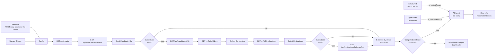

# AI-assisted scientific review: n8n + OpenRouter

Status:
- implemented and verified by recorded executions on 2026-11-08 (manual/CLI trigger);
- the webhook trigger with the real model has **not** been demonstrated (§11);
- deployment files in `infrastructure/n8n/`;
- workflow file `infrastructure/n8n/workflows/luna-ops-scientific-review.json` (workflow id
  `LunaOpsSciRev001`, 23 nodes including two sticky notes).

The live n8n copy differs from the file only in the user-selected model and the credential
reference (§6.1).

## 1. Purpose and authority boundary

The workflow asks a large language model to review **stored** LUNA-P/OPS results. It asks for
scientific limitations, missing evidence and possible next steps. It is built around four rules:

| Rule | How it is enforced |
| --- | --- |
| Python is the only scientific computation authority | n8n sends only HTTP `GET` requests to existing FastAPI endpoints. The Evidence Formatter passes stored values through unchanged. The only values n8n derives (counts, extrema, ratios to the window) are listed under `n8n_descriptive_summaries`. |
| Read-only | No `POST`/`PUT`/`DELETE` node exists. The AI Agent has **no tools**, so it cannot call any API. Recommendations are returned as data with `executed: false`. |
| Computed evidence, AI interpretation and suggestions stay distinct | Every output section carries an epistemic label: `COMPUTED_EVIDENCE`, `AI_INTERPRETATION` or `UNVERIFIED_SUGGESTION`. |
| No invented values, no safety claims | The system prompt forbids both. A post-processing node checks cited ids, numbers and terrain quantities against the evidence pack, and adds a fixed safety statement. |

AI output is never written to the LUNA-P/OPS database and is never an input to a computation.

## 2. Deployment and networking

| Item | Value |
| --- | --- |
| Compose file | `infrastructure/n8n/docker-compose.n8n.yml`, Compose project `luna-ops-n8n` (separate from the app stack) |
| Image | `n8nio/n8n:2.38.7` (pinned) |
| Port | `127.0.0.1:5678` (loopback only); editor and webhooks at http://localhost:5678 |
| Persistence | Docker volume `luna-ops-n8n-data` mounted at `/home/node/.n8n`: SQLite database, encryption key, owner account, encrypted credentials, executions |
| Workflow import | `./workflows` mounted read-only at `/workflows`; `make n8n-import` |
| Hardening | `N8N_BLOCK_ENV_ACCESS_IN_NODE=true`, `N8N_ENFORCE_SETTINGS_FILE_PERMISSIONS=true`, diagnostics, version notifications, templates and personalization disabled; `N8N_SECURE_COOKIE=false` only because the editor is plain HTTP on loopback |
| Health | container healthcheck on `/healthz` |
| Make targets | `n8n-up`, `n8n-down`, `n8n-logs`, `n8n-import` |

- **Networking.** The n8n container reaches the API through the host port that the development
  stack publishes: `http://host.docker.internal:8000`. Docker Desktop provides that name, and
  `extra_hosts: host.docker.internal:host-gateway` provides it on Linux.
- Because of this, n8n starts whether or not the API runs, and it never starts, stops or rebuilds
  the app stack.
- The base URL is a field in the workflow's **Config** node, not an environment variable, so env
  access in nodes can stay blocked.
- **Secrets.** No secret is in the repository. The OpenRouter key is entered in the n8n UI and
  stored encrypted in the volume. The workflow file contains no credential block.

## 3. Workflow structure



Settings: execution order `v1`; manual executions saved.

| Node (type, version) | Responsibility |
| --- | --- |
| Manual Trigger (1) / Webhook (2.1) | Start the run. The webhook is `POST /webhook/luna-ops/scientific-review` and responds with the last node's first item. |
| Config (Set 3.4) | Holds `api_base_url` (default `http://host.docker.internal:8000`). From the webhook body it takes `roi_id` (default `shackleton-rim-b`), `candidate_ids` (default `[]`), `max_evaluations` (default 25, clamped 1–60) and `question` (≤ 2000 chars), and it records the `trigger`. |
| LUNA-P/OPS: Health (HTTP 4.2) | `GET /api/health`. Stops the run if the API is unreachable. |
| List ROI Root Candidates (HTTP 4.2) | `GET /api/rois/{roi_id}/candidates`. JSON arrays are split into items. Errors go to an error branch that the formatter reports. |
| Seed Candidate IDs (Code 2) | Merges ROI roots with requested ids. Ids must match `^[A-Za-z0-9._:-]{1,200}$` before they enter a URL, which rejects path traversal. |
| Candidates found? (IF 2.3) | With no candidates, goes straight to the formatter, so no request is made with an empty id. |
| Get Candidate · List Candidate Children (HTTP 4.2) | Read each candidate and its direct C1 children (lineage). |
| Collect Candidates (Code 2) | Deduplicates roots, requested ids and children, and records how each was discovered. |
| List Candidate Evaluations (HTTP 4.2) | Stored evaluations per candidate (no computation). |
| Select Evaluations (Code 2) | Deduplicates, sorts by candidate time (newest first) and caps at `max_evaluations`. |
| Evaluations found? (IF 2.3) | With no stored evaluations, goes straight to the formatter. |
| Get Evaluation Manifest (HTTP 4.2) | Reproducibility manifest of each selected evaluation. |
| Scientific Evidence Formatter (Code 2) | Builds the evidence pack (§5) and the list of citable ids. |
| Computed evidence available? (IF 2.3) | With no evaluations, produces a deterministic **No Evidence Report** and makes no AI call. |
| AI Agent: Lunar Science Reviewer (Agent 3.1) | Prompt type `define`, system message (§6.2), `hasOutputParser: true`, `maxIterations: 3`, streaming off, no tools attached. |
| OpenRouter Chat Model (1) | User-configured model and credential; temperature 0.1. |
| Structured Output Parser (1.3) | Manual JSON schema (§6.3); `autoFix` off. |
| Scientific Recommendations (Code 2) | Separates the labelled sections, enforces `executed: false`, runs the output checks (§7) and adds the fixed safety statement. |
| No Evidence Report (Code 2) | Deterministic report that lists candidates without evaluations as proposed (unexecuted) evaluations. |

Every retrieval HTTP node after Health uses `onError: continueErrorOutput` and
`alwaysOutputData: true`. A missing candidate or a 404 is therefore recorded as a
`retrieval_issue` instead of aborting the run.

## 4. Data exchanged with FastAPI

| Endpoint | Fields used |
| --- | --- |
| `GET /api/health` | `api_version`, `lunar_core_version` |
| `GET /api/rois/{roi_id}/candidates` | `candidate_id` of each root |
| `GET /api/candidates/{id}` | the full `CandidateOut`: position, DEM elevation, observer height, time, DEM id/URL/resolution/nodata/coverage bounds, coordinate reference, validation status |
| `GET /api/candidates/{id}/children` | C1 candidates (`parent_candidate_id`) |
| `GET /api/candidates/{id}/evaluations` | `evaluation_id`, `candidate_id`, `candidate.selected_time_utc` (for selection only) |
| `GET /api/evaluations/{id}/manifest` | `candidate`, `parent_candidate`, `candidate_ref`, `request`, `interval`, `terrain`, `spice`, `method`, `software`, `status`, `outputs` (samples, intervals, `visible_seconds`, horizon arrays, `output_sha256`), `consistency`, `not_recorded` |

All of these are reads of stored records. The workflow deliberately does **not** call
`GET /api/candidates/{id}/terrain-screen`: although read-only, it runs a new Python computation.
Slope and roughness are therefore reported as missing evidence (§5).

**Discovery limits.**
- The API has no "list all candidates" endpoint. Candidates of the `sample-a` window are reached
  only through `candidate_ids`.
- Only direct children are followed, which is enough for the current data (lineage depth 1).

## 5. Scientific evidence supplied to the AI

The formatter returns one `evidence_pack` (`schema_version: luna-ops-evidence-pack/1`):

| Section | Content | Label |
| --- | --- | --- |
| `source` | API base URL, API and `lunar-core` versions, the endpoints used, "read-only HTTP GET of stored records" | — |
| `request` | trigger, ROI, requested ids, cap, focus question | — |
| `scope` | candidates found, candidates with stored evaluations, evaluations listed / included / omitted by the cap | — |
| `provenance_registry` | deduplicated `provenance:P1…Pn`: algorithm, method parameters, SPICE configuration, lunar radii, kernel SHA-256s, terrain datasets and hashes, software versions and commit, time sampling | `COMPUTED_EVIDENCE` |
| `computed_evidence[]` | one entry per evaluation (see below) | `COMPUTED_EVIDENCE` |
| `candidates_without_evaluations[]` | stored candidate facts with no evaluation | `COMPUTED_EVIDENCE` |
| `not_in_evaluation_records` | fixed list: DEM slope/roughness/hazards (only via the terrain-screen computation), mission constraints (stored only with brush experiments), independent validation, power/thermal/link/landing-safety analyses | — |
| `retrieval_issues` | HTTP errors and rejected ids | — |
| `epistemic_labels` | definitions of the three labels | — |

Each `computed_evidence` entry holds:
- `evidence_id` (the evaluation id) and `provenance_ref`;
- candidate facts and the snapshot SHA-256;
- `lineage` (parent and changed fields), `request`, `time_window` and `status` (execution and
  validation status, warnings, errors);
- `python_outputs`: `visible_seconds` for Sun, Earth and simultaneous; `output_sha256`; the horizon
  sample count;
- `consistency` and `not_recorded`;
- `n8n_descriptive_summaries`, which are counts, extrema and window ratios of stored values only:
  - visible fraction of the window;
  - interval count, truncated count and longest interval;
  - visible-sample counts;
  - Sun/Earth elevation and Sun azimuth ranges;
  - terrain-horizon min/max and the azimuth of the maximum.

Horizon arrays and per-sample series are summarised rather than forwarded, to bound the prompt
size. With 25 evaluations the pack is about 98 kB, and the model prompt was 32,443 tokens.

**Citable references** (`known_refs`): evaluation ids, candidate ids, provenance ids and the
sections `pack.scope`, `pack.candidates_without_evaluations`, `pack.not_in_evaluation_records`,
`pack.retrieval_issues`, `pack.source`.

## 6. AI Agent

### 6.1 Model configuration

| Setting | Value | Set by |
| --- | --- | --- |
| Credential | an OpenRouter API credential named "OpenRouter account" (key stored encrypted in the n8n volume; never shown or exported) | user |
| Model | `mistralai/mistral-large-4-0` | user |
| Temperature | 0.1 | workflow |
| Max tokens | unset (provider default) | workflow |
| Provider routing | not configured | — |

**Notes on the model.**
- `mistralai/mistral-large-4-0` uses hidden reasoning tokens before it answers. A small
  *Maximum Number of Tokens* returns empty text with `finish_reason: length`, as a 5-token test
  showed (§10.1). Leave the cap unset.
- The structured response was returned through the agent's output-format mechanism
  (`finish_reason: tool_calls`). This is internal to the AI Agent node; the agent has no tools
  that act on any system.
- OpenRouter is a US-based gateway. With this model, OpenRouter listed Mistral as the only
  inference provider. Requests nevertheless pass through OpenRouter, which is not strict EU data
  residency. The data sent consists of public NASA-derived terrain values and the project's own
  computed results, with no personal data.

### 6.2 Instructions (system message)

The system message, reproduced exactly from the workflow:

<details>
<summary>Show the full system message</summary>

```text
You are a lunar scientific research assistant reviewing outputs of LUNA-P/OPS, a south-polar landing-site exploration tool. LUNA-P/OPS's Python pipeline (SPICE ephemerides + NASA LOLA DEMs) is the sole scientific computation authority. You interpret its stored results; you never compute, simulate or invent new results.

EVIDENCE RULES
1. Use only the evidence pack in the user message. Every number you state must appear in the pack (unit conversions such as seconds to hours or fractions to percent are allowed and must be stated as conversions). Never invent measurements, coordinates, slopes, roughness, hazard data, illumination or link values.
2. Cite evidence with exact ids from the pack in evidence_refs: evaluation ids, candidate ids, provenance ids (provenance:P1, ...), or pack sections (pack.scope, pack.candidates_without_evaluations, pack.not_in_evaluation_records, pack.retrieval_issues, pack.source). Do not cite anything else.
3. If evidence is absent, say so and list it under missing_evidence. Do not fill gaps with assumptions or typical values from literature.
4. Label each statement: basis COMPUTED_EVIDENCE only when restating a value from the pack; AI_INTERPRETATION for your reasoning about it; recommendations are AI_INTERPRETATION or UNVERIFIED_SUGGESTION.
5. Respect the pack's own caveats: COMPUTED_UNVERIFIED means numerically computed and not independently validated; geometric Earth visibility is not communication performance; sunlight visibility is not a power analysis; horizon sampling can miss unsampled terrain; transitions are uncertain up to one time step; truncated intervals are cut by the analysis window.
6. n8n_descriptive_summaries are counts/extrema/ratios of stored values, not independent measurements.

SAFETY RULES
- Never state or imply that a site is safe to land, certified, validated or mission-ready. LUNA-P/OPS provides coarse screening and geometric visibility only.
- Sun/Earth visibility over a short window does not characterise seasonal or long-term illumination.
- Absence of terrain slope/roughness/hazard data in the pack means terrain safety is NOT ASSESSED.

WHAT TO PRODUCE
- Scientific limitations of the current evidence (time window length, step size, horizon resolution, DEM resolution, lineage coverage, missing validation, missing records).
- Missing evidence needed for stronger conclusions, and where it could come from.
- Possible improvements and next actions. Map each to an existing LUNA-P/OPS capability where one exists: evaluate a candidate over a longer window (POST /api/candidates/{id}/evaluations, duration_hours <= 168, step_minutes 1-360), evolve a candidate (observer height / time), coarse terrain screen (GET /api/candidates/{id}/terrain-screen), reproducibility check (POST /api/evaluations/{id}/recompute), region sampling (brush preview/execute in shackleton-rim-b). Otherwise mark it as outside LUNA-P/OPS. Nothing you recommend is executed; set executed=false and requires_new_python_computation=true whenever new numbers would be produced.

OUTPUT
Return only JSON matching the required schema. Be concise, specific and evidence-referenced. Prefer fewer well-supported findings over many speculative ones.
```

</details>

The user message asks for a review of limitations, missing evidence and improvements "without
executing them". It includes the optional focus question and the evidence pack as JSON, marked
authoritative.

### 6.3 Structured output

The Structured Output Parser uses a manual JSON schema. All of these fields are required:

| Field | Shape |
| --- | --- |
| `summary` | string |
| `evidence_assessment` | `overall_strength` ∈ {insufficient, limited, moderate, strong}, `evaluations_reviewed`, `rationale` |
| `findings[]` | `finding_id`, `category` ∈ {sun_visibility, earth_visibility, simultaneous_visibility, terrain, lineage, provenance, data_coverage, methodology}, `statement`, `basis` ∈ {COMPUTED_EVIDENCE, AI_INTERPRETATION}, `evidence_refs[]`, `confidence` ∈ {low, medium, high} |
| `limitations[]` | `limitation`, `impact`, `evidence_refs[]` |
| `missing_evidence[]` | `item`, `why_it_matters`, `possible_source` |
| `recommendations[]` | `recommendation_id`, `title`, `rationale`, `basis` ∈ {AI_INTERPRETATION, UNVERIFIED_SUGGESTION}, `evidence_refs[]`, `priority` ∈ {high, medium, low}, `proposed_action`, `luna_ops_capability`, `requires_new_python_computation`, `executed` ∈ {false} |
| `safety_statement` | string |

## 7. Recommendations, labels and output checks

The **Scientific Recommendations** node returns `schema_version: luna-ops-ai-review/1` with
`read_only: true`, `actions_executed: []`, and these sections:

| Section | Label | Content |
| --- | --- | --- |
| `computed_evidence` | `COMPUTED_EVIDENCE` | the authority statement, scope, source and the full evidence pack |
| `ai_interpretation` | `AI_INTERPRETATION` | summary, evidence assessment, findings (each with `evidence_check`), limitations, missing evidence |
| `unverified_suggestions` | `UNVERIFIED_SUGGESTION` | recommendations, forced to `executed: false`, `status: proposed_requires_human_approval` |
| `safety_statement` | — | `fixed`: "LUNA-P/OPS provides numerically computed geometric Sun/Earth visibility and coarse DEM screening only. Nothing in this review certifies landing safety, validates a site, or replaces independent analysis." plus `ai`, the model's own statement |
| `output_checks` | — | results of the automatic checks below |

**Automatic checks** (heuristic):

1. **Reference check.** Every `evidence_refs` entry must be a known id or pack section; others
   are listed in `unresolved_refs`.
2. **Number check.** Before numbers are extracted from AI text, ISO dates, ids, hash and commit
   tokens, `SHA-256`, and identifiers such as `P1`, `DE421` or `LDEM_80S_20MPP_ADJ` are removed.
   Each remaining number must match some value in the pack at its stated precision. Matches may
   also be against unit conversions (s→min/h/day, m→km, fraction→%) or collection sizes. Numbers
   that don't match are listed in `numbers_not_found_in_evidence`.
3. **Terrain-value check.** Any slope, roughness, boulder, rock, hazard, crater or relief quantity
   is flagged in `terrain_values_without_terrain_data`, because the pack never contains
   terrain-screen data.
4. **Downgrade.** A finding labelled `COMPUTED_EVIDENCE` that fails any check, or cites nothing, is
   relabelled `AI_INTERPRETATION` and listed in `downgraded_to_interpretation`.
5. **Execution flag.** Any recommendation returned with `executed ≠ false` is forced to false and
   listed in `forced_not_executed`.

`passed` is true only if checks 1–3 found nothing.

**What the checks cannot do.** A number that exists anywhere in the pack passes, even when it is
quoted as the wrong extreme of a range or is a miscounted total. Both happened in the recorded
runs (§10). **Human review of every AI statement remains required.**

## 8. Read-only behaviour and database integrity

- **By design:**
  - the workflow contains only GET HTTP nodes;
  - writing endpoints are named in the prompt only as *proposals*;
  - the agent has no tools.
- **By verification:** the SHA-1 checksum (`shasum`) of `data/candidates.sqlite3` was taken
  before and after each recorded run. It was unchanged
  (`e08c4704d39b94cecbba5e369c367f70239016fa`), and the candidate and evaluation counts stayed at
  43 and 41.
- **Evaluation-file integrity.** `computed_evidence` passes stored values through, and
  `consistency` (from the API) confirms that each candidate snapshot matches its record.

## 9. Setup and operation

1. Start the LUNA-P/OPS API: `make up`. Rebuild after backend changes; see §11 on stale images.
2. Start n8n: `make n8n-up`. Then open http://localhost:5678 and create the local owner account.
3. If the workflow is not present, run `make n8n-import`.
4. Open **OpenRouter Chat Model** and choose *Credential → Create new*. Paste your OpenRouter API
   key, then select a model. Leave *Maximum Number of Tokens* unset. Optionally, set *Options →
   Provider Routing → Data Collection* to `deny`, and *Only* to pin a provider.
5. Run it with **Execute workflow** (Manual Trigger; defaults: `shackleton-rim-b`, cap 25). To use
   the webhook, publish the workflow, then:

   ```bash
   curl -s -X POST http://localhost:5678/webhook/luna-ops/scientific-review -H 'content-type: application/json' -d '{"max_evaluations": 10, "question": "What limits the Earth-visibility conclusions?"}'
   ```

   Body fields (all optional): `roi_id` (use `""` to review only `candidate_ids`),
   `candidate_ids`, `max_evaluations` (1–60) and `question`.
6. **Caution.** `make n8n-import` replaces the n8n copy of the workflow, including UI edits. You
   must then select the credential and model again. To change one node while keeping the
   configuration, export the live workflow, patch it, and import that.
7. Stop with `make n8n-down`; the data stays in the volume. `docker volume rm luna-ops-n8n-data`
   irreversibly deletes the owner account, credentials and executions.

## 10. Case study: verified executions (2026-11-08)

All executions ran from the n8n CLI (`mode: cli`) in the `luna-ops-n8n-n8n-1` container, against
the development API. Times are UTC. The API container served image commit **`02c13f3`**
(`CLPS_BUILD_COMMIT`, built 2026-11-07). That is older than the release code, but every endpoint
the workflow uses exists in it (§11).

### 10.1 OpenRouter connectivity (temporary test workflows, now archived)

| Exec | Test | Result |
| --- | --- | --- |
| 1 | Full workflow before any credential was configured | Stopped at the OpenRouter Chat Model with "Node does not have any credentials set" (expected); all retrieval nodes succeeded |
| 2 | Minimal prompt, 5-token cap | Authenticated (35 prompt + 5 completion tokens), empty text with `finish_reason: length`, so the reasoning model needs more tokens |
| 3 | Invalid model id | Clean failure in about 0.2 s: "invalid-vendor/no-such-model-xyz is not a valid model ID" |
| 4 | Minimal prompt, 400-token cap | Reply `OK`, `finish_reason: stop`, 1.8 s model latency, 89 tokens |

The test workflows `TempOrTestOk0001` and `TempOrTestErr001` are archived in n8n and can be
deleted in the UI.

### 10.2 Full runs

| | Execution 5 | Execution 6 (latest) |
| --- | --- | --- |
| Time (UTC) | 11:28:08 → 11:29:22 | 11:36:12 → 11:37:20 |
| Status | success, all 19 executed nodes green | success, all 19 executed nodes green |
| Duration | 74.1 s (model node 72.6 s) | 68.0 s (model node 66.6 s) |
| Tokens (prompt / completion) | 32,443 / 11,948 | 32,443 / 9,181 |
| Approx. cost at the OpenRouter list price ($0.70 / $2.10 per M tokens, read on 2026-11-08) | ≈ $0.05 | ≈ $0.04 |
| Output-check version | v1 (initial) | v2 (corrected, §10.4) |
| `output_checks.passed` | false (all four flags were false positives) | **true** |
| Database checksum | unchanged | unchanged |

Retrieved evidence, identical in both runs:

| Quantity | Value |
| --- | --- |
| Candidates found | 36 (32 ROI roots + 4 children) |
| Evaluations listed / included / omitted by cap | 31 / 25 / 6 |
| Candidates with stored evaluations / without | 27 / 9 |
| Provenance variants | 8 (`provenance:P1…P8`) |
| Evidence pack size | ≈ 98 kB |

Example reference evaluation (`evaluation-7ce2f25a…`), read directly through FastAPI for
comparison:
- status `COMPUTED_UNVERIFIED` / `not_independently_validated`;
- 168 h window at 60 min steps (168 samples);
- `visible_seconds`: Sun 79,200, Earth 0, simultaneous 0;
- one truncated Sun interval and 720 horizon samples;
- near DEM `LDEM_80S_20MPP_ADJ` (20 m) with its SHA-256, and five kernel hashes;
- software commit recorded as clean; all consistency flags true.

### 10.3 AI output of execution 6 and its manual verification

The model returned 5 findings, 7 limitations, 9 missing-evidence items and 7 recommendations.
Every recommendation was `executed: false` with `requires_new_python_computation: true`. The
overall assessment was `limited`.

**Statements confirmed against the evidence pack:**
- Earth visibility is 0 s in all 25 evaluations, and simultaneous visibility is 0 s.
- Sun visibility is non-zero only in 168 h windows, between 14,400 and 79,200 s (2.38–13.1 % of
  the window), each a single interval truncated by the window.
- All evaluations start at 2026-11-07T00:00Z at a 60 min step, with durations of 6, 24, 72 and
  168 h.
- Repeat evaluations of the same candidate have identical `output_sha256` across P1/P2, P2/P4
  and P6/P7/P8.
- Provenance P3 lacks `software_commit` and `clps_api_version`; P5 lacks
  `software_commit_source`; P6 and P8 are dirty commits.
- Coverage: 36 candidates, 9 without evaluations, 6 evaluations omitted by the cap.

**Errors found by manual verification** (none detected by the automatic checks):
- **Wrong count.** The model stated that 8 evaluations (and, in R1/R6, "8 candidates") had
  non-zero Sun visibility, and 17 had none. The stored data has **11** such evaluations at 11
  distinct candidates, and **14** with none. Eight is the number of *distinct* `visible_seconds`
  values.
- **Omission.** P5 (`88d68ee-dirty`) is also a dirty commit but was not listed as one.
- **Wording.** The AI safety statement says "No candidate in this pack is safe to land…". The
  accurate statement is that safety is *not assessed*. The fixed statement that accompanies it is
  correct.

**Recommendations returned** (proposals, not executed):

| ID | Priority | Proposal | LUNA-P/OPS capability |
| --- | --- | --- | --- |
| R1 | high | Run the coarse terrain screen on the Sun-visible candidates, starting with the highest Sun-visible time | `GET /api/candidates/{id}/terrain-screen` |
| R2 | high | Re-evaluate candidates evaluated only over 6/24/72 h over 168 h with a finer step (15 min) | `POST /api/candidates/{id}/evaluations` |
| R3 | medium | Reproducibility-check evaluations from dirty or incomplete provenance (P3, P5, P6, P8) | `POST /api/evaluations/{id}/recompute` |
| R4 | medium | Evaluate the 9 candidates without stored evaluations | `POST /api/candidates/{id}/evaluations` |
| R5 | medium | Sample the region with thresholds using the brush | brush preview / execute |
| R6 | low | Test observer-height sensitivity on Sun-visible candidates via C1 revisions | evolve + evaluate |
| R7 | medium | Commission independent validation and mission-level analyses | outside LUNA-P/OPS |

R1 requires the terrain-screen route, which the API image used in this run (`02c13f3`) does not
serve. An image rebuilt from this branch (`make up`) does.

### 10.4 Output-check revision (tested)

Execution 5 exposed false positives in the v1 number check. It extracted numbers from commit
hashes (`1a3608a2…`), `SHA-256`, the dataset name `LDEM_80S…` and "8 km", and it wrongly
downgraded three correct findings. It also showed that the check accepts small invented numbers
that happen to occur in a large pack.

The v2 change, made in the Scientific Recommendations node only:
- strips hash, commit and identifier tokens;
- accepts m→km conversions and collection sizes;
- adds the terrain-value check (§7, item 3).

It was tested in three steps:
1. offline, against the stored execution-5 output: all findings passed, with no downgrades;
2. with adversarial inputs: "5 deg slope", "0.37 m roughness" and "17 boulders" are flagged, while
   "no slope data" and true Sun values pass;
3. in n8n, by execution 6.

**No workflow or checker change was made after execution 6.**

Execution 5's output also contained two range slips that neither check version detects:
- a Sun-elevation maximum of 1.755° where the true maximum is 1.765°;
- a horizon-maximum low end of 14.22° where the true value is 14.13°.

Both quoted values exist in the pack as second-ranked entries.

### 10.5 Verification outcome

The success criterion was met. A complete n8n execution:
1. retrieved real stored LUNA-P/OPS evidence read-only;
2. processed it through the configured OpenRouter model with valid structured output;
3. returned evidence-referenced limitations and recommendations without errors or writes.

The scientific content is largely correct but **not error-free**, which confirms that the human
review step is necessary.

## 11. Limitations and open issues

- **Webhook with the real model not demonstrated.** All AI runs used the Manual Trigger through the
  n8n CLI. The webhook path was exercised only with a mock-AI copy before the credential existed.
- **Stale API image.** The development API image used in the runs predates the release code, so it
  lacks `terrain-screen` and `brush-experiments`. Rebuild with `make up` before relying on
  recommendations that reference those routes.
- **Counts and ranges.** The model can miscount, or pick a wrong extreme, from correct values. A
  possible mitigation, **not implemented**, is for the formatter to compute these totals and
  extrema in advance so the model can quote them.
- **Safety wording.** Overcautious wording ("not safe") is possible despite the prompt.
- **Discovery.** Only ROI roots, their direct children and explicit ids are reviewed. `sample-a`
  candidates need `candidate_ids`.
- **No terrain-screen evidence.** Slope and roughness are never in the pack, by design. Brush
  experiment snapshots, the only stored source of constraints and screens, are not retrieved.
- **Cost and latency.** About 32 k prompt tokens and 70 s per run with 25 evaluations. Lower
  `max_evaluations` to reduce both.
- **Model dependence.** Results were observed with one model at temperature 0.1. Other models may
  behave differently, and outputs are not bit-reproducible.
- **Privacy.** Requests go to OpenRouter, an external service.
