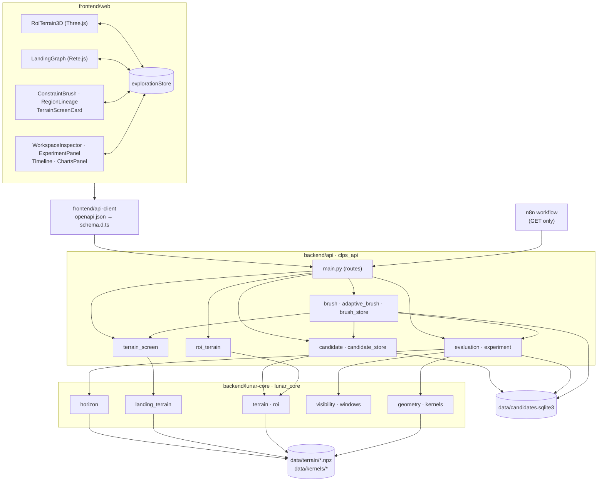
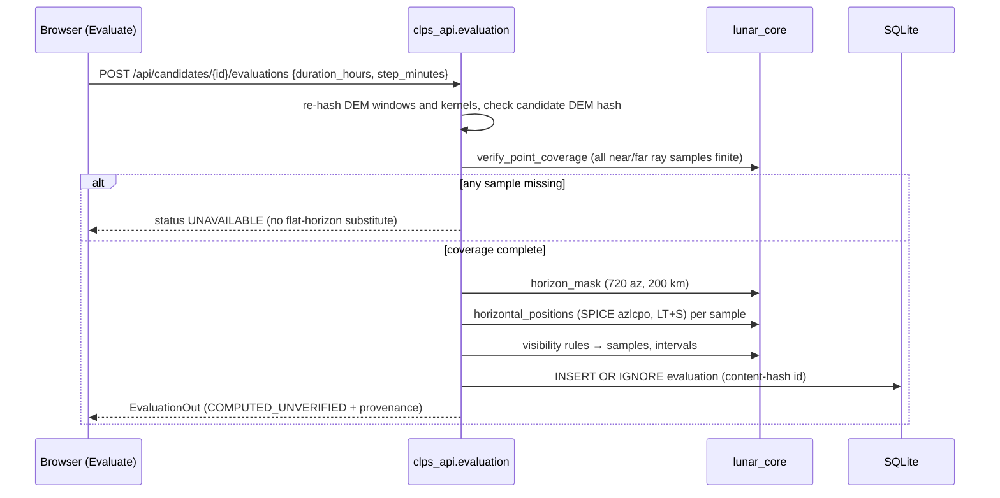

# LUNA-P/OPS architecture

Status: this describes the release state of branch `feat/terrain-aware-brush` (Experiment B and
the n8n integration on top of `7cdbb8c`), reviewed on 2026-11-08. Technical package and service names (`clps_api`, `lunar_core`,
`@clps/web`, `CLPS_DATA_DIR`, the Docker service names) are kept from the upstream CLPS Lunar
Mission Browser for compatibility. Scientific methods are in
[SCIENTIFIC_METHODOLOGY.md](SCIENTIFIC_METHODOLOGY.md). The exploration logic is in
[ADAPTIVE_EXPLORATION.md](ADAPTIVE_EXPLORATION.md). The AI workflow is in
[AI_N8N_INTEGRATION.md](AI_N8N_INTEGRATION.md).

## 1. Layers and authority

| Layer | Location | Responsibility |
| --- | --- | --- |
| Scientific core | `backend/lunar-core` (`lunar_core`) | Pure Python with no web code: projection, DEM grids, horizon masks, SPICE geometry, visibility rules, windows, the ROI definition and terrain screening. The only place physical rules live. |
| API | `backend/api` (`clps_api`, FastAPI) | Candidate creation, evaluation, brush orchestration and adaptive selection, terrain-screen service, experiment manifests, SQLite persistence, provenance. Calls into `lunar_core` and never adds its own physics. |
| Data pipelines | `backend/pipelines` (`clps_pipelines`) | Download bounded LOLA windows, SPICE kernels and the pole-map relief into `data/`; the Horizons golden file; the PSR comparison spike. |
| API client | `frontend/api-client` | OpenAPI schema and generated TypeScript types (`make openapi`), fetched with `openapi-fetch`. |
| Web app | `frontend/web` (React 19, TypeScript, Vite) | Interaction and display only: Three.js terrain, Rete.js graph, Inspector, Timeline, Region Brush and the original catalog comparison. |
| AI orchestration | `infrastructure/n8n` (n8n 2.38.7) | Read-only retrieval of stored records, evidence formatting, AI interpretation via OpenRouter, output checks. No scientific computation and no writes. |
| Infrastructure | `infrastructure/`, `compose.yaml`, `Makefile` | Development, production, isolated E2E and n8n Docker stacks. |

**Authority rule.** Only Python computes scientific values. Display heights, exaggeration, mesh
curvature, lighting and rays in the 3D view are visual. Every stored or reported number comes from
an API response. n8n only reformats stored values: it selects, counts, takes extrema and computes
ratios to the window, and labels them as such. The AI interprets but never measures.



## 2. Backend modules

`lunar_core` (scientific core):

- `terrain.py`: spherical south polar stereographic projection on R = 1737.4 km (+y toward 0°E,
  +x toward 90°E), and `TerrainGrid` with bilinear sampling at pixel centres (NaN outside).
- `roi.py`: the Shackleton Rim B ROI (±2 km study square; 12 km near and 205 km far download
  windows) and the ROI-centre local east/north frame.
- `horizon.py`: terrain horizon mask (great-circle rays over two nested grids).
- `geometry.py`, `kernels.py`: SPICE apparent positions (`azlcpo`) and kernel loading.
- `visibility.py`, `windows.py`: Sun upper-limb and Earth centre rules; sampled windows.
- `landing_terrain.py`: `SurfaceSlope`, `TerrainRoughness`, `TerrainQuality` and
  `LandingZoneScreen`, vectorized and chunked; algorithm `landing-terrain-screen-v1`.
- `analysis.py`, `sites.py`, `assumptions.py`, `pole_map.py`, `terrain_patch.py`: the upstream
  catalog comparison.

`clps_api` (service layer):

- `candidate.py`: C0 creation from local offsets, DEM re-sampling, content-hash identity.
- `candidate_store.py`: SQLite `candidates` table; C1 derivation (`evolve`); a read-only existence
  check for brush previews.
- `evaluation.py`: strict per-candidate evaluation (`compute`), storage (`save`), provenance,
  software commit and bounded in-process caches (horizon and evaluation).
- `brush.py`: polygon validation, lattice sampling, preview token, batch execution, metrics,
  constraint verdicts, the combined visibility + terrain verdict, the Pareto front and the
  temporal refinement.
- `adaptive_brush.py`: deterministic seed and refinement policy, with an optional terrain context
  (Experiment B).
- `brush_store.py`: append-only `brush_experiments` snapshots of completed adaptive runs.
- `terrain_screen.py`: terrain screens of ROI points and stored candidates.
  Provides provenance, content-addressed screen IDs and an in-process metric cache keyed by the
  DEM SHA-256.
- `experiment.py`: experiment manifest and recompute-and-compare.
- `roi_terrain.py`:
  - 4 km display grid (20 m) with coverage checks;
  - 40 km regional display grid (161 × 161 nodes, 250 m spacing, bilinear samples of the 240 m
    DEM). It contains the south pole, at local 0 m E, −14.42 km N.
- `service.py`, `pole_map.py`, `terrain_store.py`: the original catalog comparison.

SPICE calls are serialized with a lock (`SPICE_LOCK`) because CSPICE is not thread-safe. At
start-up the API records the SHA-256 of the loaded kernels, and it refuses to evaluate if the
kernel files change while it runs.

## 3. API contract

Interactive documentation is at `/docs` on a running API. The authoritative contract is
`frontend/api-client/openapi.json` (25 paths).

| Method and path | Effect | Writes |
| --- | --- | --- |
| `GET /api/health` | API and `lunar-core` versions | — |
| `GET /api/rois` | List ROIs and whether their LOLA windows are present | — |
| `GET /api/rois/{roi_id}/terrain` | 4 km display grid, corners, coverage checks, datasets, limitations | — |
| `GET /api/rois/{roi_id}/regional-terrain` | 40 km display-only far-field grid and its corners | — |
| `POST /api/rois/{roi_id}/candidates` | Create (or reuse) a C0 at local east/north offsets | **yes** |
| `GET /api/rois/{roi_id}/candidates` | Root (C0) candidates of the ROI | — |
| `POST /api/rois/{roi_id}/brush/preview` | Validate and sample a polygon; returns a preview token | — (read-only DB connection) |
| `POST /api/rois/{roi_id}/brush/execute` | Evaluate a confirmed preview (`confirmed: true` and the token) | **yes** |
| `GET /api/brush-experiments/{experiment_id}` | Read a stored adaptive experiment snapshot | — |
| `GET /api/candidates/{id}`, `/ref`, `/children` | Read a candidate, its reference hash, its C1 children | — |
| `GET /api/candidates/{id}/terrain-screen?…` | Terrain screen at a stored candidate with the given limits | — (computed, never stored) |
| `POST /api/candidates/{id}/evolve` | Derive a C1 (observer height, time) | **yes** |
| `POST /api/candidates/{id}/evaluations` | Compute and store an evaluation | **yes** |
| `GET /api/candidates/{id}/evaluations`, `GET /api/evaluations/{id}` | Read stored evaluations | — |
| `GET /api/evaluations/{id}/manifest` | Reproducibility manifest built from stored records | — |
| `POST /api/evaluations/{id}/recompute` | Recompute and compare | — (never stores) |

The catalog endpoints (`/api/sites…`, `/api/analysis`, `/api/map…`) are unchanged from upstream.
`POST /api/sites/{site_id}/candidate` (accepted only for `sample-a`) also writes a candidate. The `brush-experiments` and
`terrain-screen` routes were added with Experiment B. An API image built from an earlier commit
(for example `02c13f3`) does not serve them, so rebuild with `make up`.

The n8n workflow uses only `GET /api/health`, `GET /api/rois/{roi_id}/candidates`,
`GET /api/candidates/{id}`, `GET /api/candidates/{id}/children`,
`GET /api/candidates/{id}/evaluations` and `GET /api/evaluations/{id}/manifest`.

### Evaluation request flow



## 4. Frontend state and interaction

- `lib/explorationStore.ts` is the single shared state (`useSyncExternalStore`). It holds:
  - `context` (candidate or catalog), `rootId`, `revisionId`, `evaluation`, `cursorUtc`;
  - `draft`, `settings`, `playing`, `activity`;
  - region state (regions, active region, drawing mode, inspected result);
  - a separate `catalog` sub-state.

  Its header comment lists which actions may change display, draft, persisted and evaluation state.
- Writes happen only on explicit actions:
  - a terrain click inside the study area (C0);
  - **Create Candidate C1**;
  - **Evaluate**;
  - the confirmed brush execution.

  Cursor, camera, hover, selection and the terrain-screen node never call a writing endpoint. The
  browser tests assert this.
- `App.tsx` persists identifiers only (root, revision, evaluation, cursor, context) to
  `localStorage`. It debounces by 300 ms, flushes on `pagehide`, and re-reads every record from
  the API on load.
- `components/RoiTerrain3D.tsx` (Three.js) renders one scene, swapping the 40 km and 4 km grids.
  - Candidates are created only on the 4 km grid, inside the study area, and never while a region
    evaluation runs.
  - Sky geometry (paths, trail, cursor ray, horizon silhouette) is built from the stored
    evaluation by the pure helpers in `lib/sceneGeometry.ts`, on a symbolic dome.
  - The canvas exposes `data-*` attributes (path counts, cursor index, drawn Sun/Earth directions,
    hover coordinates) that the browser tests compare with the API.
- `components/LandingGraph.tsx`, `landingGraph.ts` (Rete.js v2 with `rete-engine`):
  - Location, Terrain, Observer Height, Time → Candidate (`preview`, `candidate_ref`) →
    Scientific computation (memoised; runs only on Evaluate) → Results;
  - a **Terrain screen** node on `candidate_ref`, which issues a GET.

  There are no region-level nodes.
- `components/ConstraintBrush.tsx` is the Region Brush dock.
  - Every edit increments a region's revision and discards its preview and results view.
    Responses apply only to the revision they were requested for.
  - Region definitions are saved to `localStorage` (`lunar-ops-regions`); previews and results are
    not.
  - `RegionLineage.tsx` shows the selected candidate's region lineage, read-only.
  - `TerrainScreenCard.tsx` shows a terrain screen.
- `components/WorkspaceInspector.tsx`, `ExperimentPanel.tsx`, `ContextBar.tsx`: inspection,
  manifest export, recompute-and-compare, active-context bar.
- The original catalog UI (`ChartsPanel`, `SkyChart`, `Timeline`, `PoleMap`, …) is intact. Its sky
  diagram and timeline are reused to display stored candidate evaluations.

## 5. Persistence

`data/candidates.sqlite3` (path from `CLPS_DATA_DIR`, default `data`):

```sql
CREATE TABLE candidates        (id TEXT PRIMARY KEY, parent TEXT, payload TEXT NOT NULL);
CREATE TABLE evaluations       (id TEXT PRIMARY KEY, candidate_id TEXT NOT NULL, payload TEXT NOT NULL);
CREATE TABLE brush_experiments (id TEXT PRIMARY KEY, payload TEXT NOT NULL);  -- created on first adaptive run
```

- Payloads are the JSON of `CandidateOut`, `EvaluationOut` and `BrushExecutionOut`.
- Inserts use `INSERT OR IGNORE` followed by a read-back comparison. Identical records are reused;
  a different payload under an existing ID raises an identity collision. The application never
  updates or deletes a record.
- Identities:

  | Record | Identity |
  | --- | --- |
  | C0 candidate | SHA-256 of site ID, latitude, longitude, observer height, UTC time, DEM source URL, DEM window SHA-256, DEM resolution, coordinate reference and sampled elevation |
  | C1 candidate | SHA-256 of parent ID, observer height and UTC time |
  | Evaluation | SHA-256 of the whole result (candidate, request, provenance, status, errors, warnings, samples, intervals, horizon). A rerun with identical data and code reuses the record. |
  | Brush experiment | `brush-<SHA-256>` of the completed execution. `candidate-set-<SHA-256>` identifies the ordered set of locations, candidates and evaluations. |
  | Terrain screen | Content hash of DEM SHA-256, algorithm, location, limits and metrics. Not stored separately; it is embedded in brush experiment snapshots. |

- The brush preview checks existing IDs through a read-only (`mode=ro`) connection and never
  creates the database file.

## 6. Provenance recorded per evaluation

- algorithm ID (`candidate-horizon-spice-v1`), horizon parameters, visibility rules and the
  time-sampling rule;
- SPICE settings;
- near/far DEM source URLs, window SHA-256s and resolutions;
- kernel SHA-256s and the SPICE lunar radii;
- versions of `lunar-core`, `clps-api`, `spiceypy` and `numpy`;
- the software commit: `CLPS_BUILD_COMMIT` baked into the image by `make up`, or `CLPS_GIT_COMMIT`
  at runtime, with `-dirty` when the tree had uncommitted changes. Under `make dev` live sync, the
  recorded commit describes the image build, not later synced edits.

Terrain screens record the DEM SHA-256, source, resolution, algorithm and versions.

## 7. Docker stacks

| Stack | File | Data | Ports |
| --- | --- | --- | --- |
| Development | `compose.yaml` → `infrastructure/docker-compose.yml` | `./data` bind mount (real database) | web 5180, API 8000 |
| Production | `infrastructure/docker-compose.prod.yml` | named volume `clps-data`; nginx + API | one port, `WEB_PORT` (default 8080) |
| Isolated E2E | `infrastructure/docker-compose.e2e.yml` | kernels/terrain/basemap read-only; database in `tmpfs` | web `127.0.0.1:15180` |
| n8n | `infrastructure/n8n/docker-compose.n8n.yml` (project `luna-ops-n8n`) | named volume `luna-ops-n8n-data` | `127.0.0.1:5678` |

The development `data` service runs `clps-fetch-kernels`, `clps-fetch-terrain` (catalog sites) and
`clps-fetch-basemap`. The Shackleton Rim B windows come from
`python -m clps_pipelines.fetch_roi`, which that service does not run.

The n8n stack is a separate Compose project. It reaches the API through the host port
(`http://host.docker.internal:8000`, with `extra_hosts: host-gateway` for Linux), so it never
starts, stops or rebuilds the LUNA-P/OPS stack. See
[AI_N8N_INTEGRATION.md](AI_N8N_INTEGRATION.md#2-deployment-and-networking).

## 8. Dependencies

| Component | Main dependencies (declared ranges) |
| --- | --- |
| `lunar-core` | Python 3.12, `numpy>=2.5.3`, `spiceypy>=8.2.0` |
| `clps-api` | `fastapi>=0.115`, `uvicorn[standard]>=0.34`, `lunar-core` (uv workspace) |
| `clps-pipelines` | `pyproj>=3.8.0`, `rasterio>=1.5.1` |
| Web app | `react`/`react-dom ^19.3.0`, `three ^0.186.0`, `rete ^2.0.6` + area/connection/engine/react/render-utils plugins, Vite 8, TypeScript 5.9, Vitest 5, Playwright 1.63, ESLint 10 |
| API client | `openapi-typescript ^7.13.0`, `openapi-fetch ^0.17.0` |
| n8n | `n8nio/n8n:2.38.7`; nodes: Manual Trigger 1, Webhook 2.1, Set 3.4, HTTP Request 4.2, Code 2, IF 2.3, AI Agent 3.1, OpenRouter Chat Model 1, Structured Output Parser 1.3 |

Python dependencies are locked in `backend/uv.lock`; frontend dependencies in
`frontend/pnpm-lock.yaml`. Versions actually used in an evaluation are recorded in its provenance.
