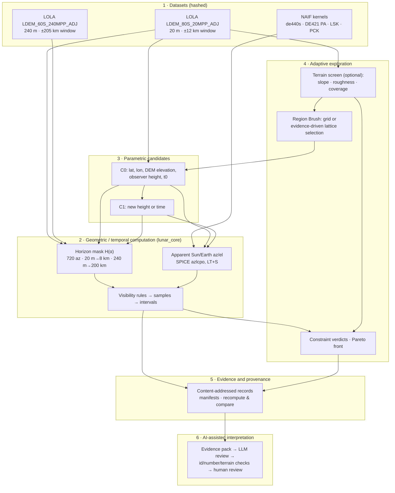

# LUNA-P/OPS scientific methodology

Status: describes the release state of branch `feat/terrain-aware-brush` (Experiment B and the n8n
integration on top of `7cdbb8c`), reviewed on 2026-11-08. Code references are to `backend/lunar-core/src/lunar_core`
(`lunar_core`) and `backend/api/src/clps_api` (`clps_api`).

This document states what is computed and how. It keeps four levels apart:

- **implemented computation**;
- **automated software verification**;
- **numerical comparison with independent reference data**;
- **independent scientific validation**.

Only the first three exist today ([§10](#10-verification-levels)). The full verification record
is in [VERIFICATION_AND_LIMITATIONS.md](VERIFICATION_AND_LIMITATIONS.md).

## 1. End-to-end method

Each stage consumes only what the previous stage produced and recorded:

1. Datasets are bounded windows of NASA products, cached locally and identified by SHA-256.
2. Computation turns one candidate and one time interval into a horizon mask, apparent body
   positions and sampled visibility (§3–§7).
3. Candidates fix the inputs of a computation as immutable, content-addressed records (§2.4).
4. Exploration chooses *which* candidates to compute: a uniform grid, or a deterministic policy
   that reads computed evidence (§8, and [ADAPTIVE_EXPLORATION.md](ADAPTIVE_EXPLORATION.md)).
5. Evidence records carry the hashes, versions and commit needed to reproduce each number (§9).
6. AI interpretation reads stored evidence only. Its output is labelled interpretation or proposal
   and is never fed back as a measurement (§11).

## 2. Data products and coordinate systems

### 2.1 Data products

| Product | Resolution | Window used | Role |
| --- | --- | --- | --- |
| LOLA `LDEM_80S_20MPP_ADJ.TIF` (PGDA) | 20 m/px | ±12 km around the ROI centre (`shackleton-rim-b_near.npz`) | candidate elevation, near-field horizon, 4 km display grid, terrain screen |
| LOLA `LDEM_60S_240MPP_ADJ.TIF` (PGDA) | 240 m/px | ±205 km around the ROI centre (`shackleton-rim-b_far.npz`) | far-field horizon, 40 km display grid |
| NAIF `de440s.bsp` | — | — | Sun, Earth, Moon ephemerides |
| NAIF `moon_pa_de421_1900-2050.bpc`, `moon_080317.tf` | — | — | lunar orientation; `MOON_ME` (DE421 mean Earth / polar axis) frame |
| NAIF `pck00011.tpc`, `naif0012.tls` | — | — | lunar radii (spherical, 1737.4 km), leap seconds |

- Both DEMs give heights in metres above the 1737.4 km reference sphere, in a south polar
  stereographic projection.
- The windows are read with HTTP range requests from the cloud-optimized GeoTIFFs and stored as
  `.npz` files (float32 heights, origin, pixel size, source URL).
- The cached files have no separate nodata mask; NaN in the source remains NaN.
- Every evaluation re-hashes the windows and checks the source URLs and resolutions (20 m and
  240 m). It refuses to run if the candidate's stored near-field window hash differs from the
  current file.

### 2.2 Geographic and projected coordinates

- **Geographic:** planetocentric latitude φ and east longitude λ ∈ [0°, 360°), frame `MOON_ME`.
  This is the frame of the LOLA products, so no frame transformation is applied between terrain
  and SPICE.
- **Projected** (`terrain.polar_stereographic_south`): spherical south polar stereographic on
  R = 1737.4 km, origin at the pole, +y toward 0°E:

  ρ = 2R · tan(π/4 + φ/2),  x = ρ · sin λ,  y = ρ · cos λ.

  The point scale factor is k = 2 / (1 + sin|φ|), true at the pole. At the ROI centre
  (φ = −89.5244°) it is about 1.00002.

### 2.3 ROI-local east/north frame

Offsets are in projected metres along the *ROI centre's* axes (`roi.local_frame`), with
λ₀ = 56.30993°:

- east = (cos λ₀, −sin λ₀);
- north = (sin λ₀, cos λ₀).

Brush polygons, lattice sampling and 3D picking use this frame.

- It is a plane frame, not local geodetic east/north at each point. The ROI centre is only
  ~14.4 km from the pole, so across the 4 km square the local meridian direction rotates by up to
  about ±9° relative to the centre axes. Spacing in metres is accurate (k ≈ 1).
- Azimuths reported by SPICE and by the horizon mask are local true-north azimuths at each
  candidate. The 3D view rotates them into the centre frame for display
  (`sceneGeometry.roiAzimuth`: az + λ_candidate − λ₀).

### 2.4 Candidate position and identity

The local offset is mapped to projected (x, y) and converted to (φ, λ) by the inverse projection.
The elevation is bilinearly sampled from the 20 m grid at that exact (x, y); display-grid heights
are never used.

- A **C0** identity is the SHA-256 of the site ID, φ, λ, observer height, UTC time, DEM source
  URL, DEM window SHA-256, DEM resolution, coordinate reference and sampled elevation.
- A **C1** identity is the SHA-256 of the parent ID, observer height and time.

## 3. Terrain horizon (`horizon.horizon_mask`)

For an observer at (φ₀, λ₀) and azimuth α (720 azimuths, 0.5° step, clockwise from local north),
rays follow great circles on the sphere. A sample at ground distance d has central angle
θ = d / R and position:

sin φ = sin φ₀ cos θ + cos φ₀ sin θ cos α,
λ = λ₀ + atan2(sin α sin θ cos φ₀, cos θ − sin φ₀ sin φ).

- **Near field:** samples every 20 m from 20 m to < 8 km, on the 20 m DEM.
- **Far field:** samples every 240 m from 8 km to < 200 km, on the 240 m DEM.
- Heights are bilinear samples.

With observer radius r_o = R + h_ground + h_observer and target radius r_t = R + h(d), the
elevation angle of a sample (exact spherical geometry, curvature included) is

ε(d) = atan2(r_t cos θ − r_o, r_t sin θ),

and the horizon is H(α) = max_d ε(d). Between azimuths the mask is linearly interpolated.

- **Coverage requirement** (`evaluation.verify_point_coverage`): before computing, every near and
  far ray sample must be finite. Any missing sample makes the evaluation `UNAVAILABLE`. A flat
  horizon is never substituted.
- The nested near/far maps follow the upstream design (ADR 0009, after Barker et al. 2023). ADR
  0009 chooses 200 km because curvature already hides a peak of about 7 km, the highest polar
  relief, at that distance. Terrain beyond 200 km, and relief between samples, is not
  represented.

## 4. Ephemerides and apparent positions (`geometry.horizontal_positions`)

- SPICE `azlcpo` is called with aberration correction `LT+S` (light time and stellar aberration),
  azimuth clockwise from north, elevation positive up and no refraction (airless body).
- The observer position is computed with `georec` on the SPICE Moon radii. The API checks that
  the radii equal the DEM reference sphere (1737.4 km) to 1 mm, so the local vertical is radial
  and consistent with the horizon geometry.
- Times are UTC, converted with the leap-second kernel. DE421 lunar orientation covers 1900–2050.

## 5. Visibility rules (`visibility.py`)

With apparent elevation e and azimuth α of a body, and horizon mask H:

- **Sun** (upper limb): visible ⇔ e☉ + s☉ > H(α☉). The apparent semidiameter is
  s☉ = asin(R☉ / d☉), with R☉ = 695,700 km and d☉ the instantaneous distance.
- **Earth** (centre): visible ⇔ e⊕ > H(α⊕) + c, with clearance c = 0° in candidate evaluations.
  The Earth's apparent radius (~0.95°) is ignored, so partial-disc visibility counts as not
  visible.
- **Simultaneous:** both are true at the same sample.

These are geometric line-of-sight tests at a single point. They do not model surface
illumination, solar-panel orientation, power, antenna patterns, link budgets or multipath.

## 6. Temporal discretization and metrics

- Sample times are tₖ = t₀ + k·Δt for k = 0 … ⌈T/Δt⌉ − 1 over the half-open interval
  [t₀, t₀ + T). Each sample represents the state until the next sample. T ≤ 168 h and Δt is
  1–360 min.
- **Intervals** (`windows.build_windows`): runs of equal visibility. The last interval ends at the
  window end and is marked `truncated` if it touches either edge. Transition times are uncertain by
  up to one step.
- **Fractions** (`brush.summarize`): f_body = N_visible / N over the stored samples. A partial
  final step counts as a full sample.
- **Longest darkness** and **longest Earth gap** are the longest non-visible sampled intervals, in
  hours.
- **Visible seconds** in the experiment manifest are sums of the stored interval durations.
- The Timeline cursor moves only between stored samples. Nothing is interpolated between them.

## 7. Terrain screening (`lunar_core/landing_terrain.py`)

This is coarse DEM screening of a location on the 20 m window, computed in Python only.

- DEM nodes are laid out on the point's local east/north axes at the DEM pixel spacing Δ on the
  ground (map offsets multiplied by the scale factor), and sampled bilinearly.
- Heights are relative to the 1737.4 km sphere, which is therefore the local horizontal.

- **SurfaceSlope.** Horn's (1981) 3 × 3 gradient, with neighbours named by compass direction:

  ∂z/∂e = [(z_NE + 2·z_E + z_SE) − (z_NW + 2·z_W + z_SW)] / (8Δ)
  ∂z/∂n = [(z_NW + 2·z_N + z_NE) − (z_SW + 2·z_S + z_SE)] / (8Δ)

  The slope is atan(√((∂z/∂e)² + (∂z/∂n)²)).

  Three values are reported:
  - the local slope at the point, over a 40 m baseline;
  - the maximum Horn slope over neighbourhood nodes with a complete stencil;
  - the slope of the least-squares plane z = a + b·e + c·n through the valid nodes of the
    neighbourhood disc (default radius 100 m, range 40–500 m): atan(√(b² + c²)).
- **TerrainRoughness:** the RMS of the plane residuals, √(mean(r²)); the residual relief
  max r − min r; and the raw elevation range.
- **TerrainQuality:** valid nodes / neighbourhood nodes, DEM resolution, sampling spacing and
  interpolation. Four aspects are always `NOT_ASSESSED`: DEM vertical uncertainty, LOLA track
  density, hazards below ~2 pixels, and regolith properties.
- **LandingZoneScreen:**
  - Inputs: optional limits on local slope, plane slope, RMS roughness and residual relief, plus a
    minimum DEM coverage (default 100 %).
  - A limit left empty is not a check and never passes.
  - If coverage is below the minimum, the coverage check fails and the other checks are
    `NOT_ASSESSED`.
  - Verdict: `FAIL` if any check fails. `NOT_ASSESSED` if any configured check could not be
    assessed, or if no terrain limit is configured. Otherwise `PASS`.
  - The margin of a check is m = (L − v) / L. The screen margin is the smallest assessed terrain
    margin, with coverage excluded.
- Each screen has a content-addressed ID built from the DEM SHA-256, the algorithm
  (`landing-terrain-screen-v1`), the location, the limits and the metrics.

A `PASS` means "passes this coarse DEM screen", not certified landing safety.

## 8. Region sampling, verdicts and multi-objective comparison

The full description is in [ADAPTIVE_EXPLORATION.md](ADAPTIVE_EXPLORATION.md). In brief:

- **Lattice:**
  - points at integer multiples of the spacing (≥ 20 m) in ROI-local east/north, inside a
    3–64-vertex simple polygon;
  - at most 64 attempts, and at most 8,192 location-time samples in the worst case.

  Each point becomes a candidate under the same rules as a terrain click and is evaluated by the
  same `evaluation.compute`. There is no second engine.
- **Visibility verdict:**
  - `PASS` if f☉ ≥ f☉,min, f⊕ ≥ f⊕,min, f_sim ≥ f_sim,min, and the optional maxima on longest
    darkness and longest Earth gap hold (thresholds are inclusive); otherwise `FAIL`;
  - `UNAVAILABLE` for missing DEM or coverage;
  - `ERROR` for any other failure;
  - `NOT_EVALUATED` for the temporal refinement attempt, which has no full-window verdict.
- **Combined verdict:** when terrain limits are configured, a visibility `PASS` becomes the
  terrain verdict (`PASS`, `FAIL` or `NOT_ASSESSED`).
- **Pareto front** (`brush.pareto_indices`): among `PASS` results, a result is non-dominated if no
  other result is at least as good in every objective and strictly better in one. The objectives
  are (f☉, f⊕, f_sim, −longest darkness, −longest Earth gap), plus (−plane slope, −RMS roughness)
  when terrain limits are configured. It is a descriptive flag over the evaluated set, not an
  optimum over the region.

## 9. Evidence and provenance

Each evaluation stores:

- the algorithm (`candidate-horizon-spice-v1`), horizon parameters, visibility and sampling rules;
- SPICE settings and the lunar radii;
- the near/far DEM URLs, SHA-256s and resolutions, and the kernel SHA-256s;
- library versions and the software commit;
- the warnings that state its limits.

The **experiment manifest** (`GET /api/evaluations/{id}/manifest`) rebuilds these from stored
records. It lists any field an older record did not store under `not_recorded`, and reports
consistency checks (candidate record exists, snapshot hash matches, IDs match).

**Recompute & compare** (`POST /api/evaluations/{id}/recompute`) reruns the stored inputs, without
storing the result. It reports input checks, an outcome (`reproduced`, `differs`,
`inputs_changed`) and numerical differences within stated tolerances (angles 1e-9°, durations
1e-6 s). Agreement shows repeatability with the same data and code, not scientific validation.

## 10. Verification levels

| Level | Exists? | Summary |
| --- | --- | --- |
| Implemented computation | yes | §2–§9. Every stored result is `COMPUTED_UNVERIFIED` or `UNAVAILABLE`. `VALIDATED` exists in the schema but is never assigned. |
| Automated software verification | yes | Unit and integration tests of projection, sampling, horizon, visibility, windows, coverage, identity, brush, adaptive policy and terrain screening, plus browser tests. They show the code does what it was designed to do, not that the design is scientifically correct. |
| Numerical comparison with independent reference data | partly | SPICE geometry vs **JPL Horizons** (4 points over 2026, max error 0.05″; test tolerance 1″). Projection vs **pyproj**. Cached 20 m window vs the source GeoTIFF read independently. Horizons vs the **LOLA PSR map** around catalog sites (upstream, not rerun). None covers the Shackleton Rim B points directly. |
| Independent scientific validation | **no** | No comparison with an independent illumination or Earth-visibility product at the Shackleton Rim B points, and no external review. |

Details, commands and recorded results are in
[VERIFICATION_AND_LIMITATIONS.md](VERIFICATION_AND_LIMITATIONS.md).

## 11. AI-assisted interpretation: epistemic status

The n8n workflow ([AI_N8N_INTEGRATION.md](AI_N8N_INTEGRATION.md)) adds **interpretation**, not
measurement.

- The model receives an evidence pack built from stored records. Values are passed through
  unchanged and labelled `COMPUTED_EVIDENCE`. Counts, extrema and window ratios derived by n8n are
  listed separately as `n8n_descriptive_summaries`.
- Its output is labelled `AI_INTERPRETATION` (findings, limitations, missing evidence) or
  `UNVERIFIED_SUGGESTION` (recommendations, never executed).
- Automatic checks verify that cited ids exist and that numbers occur in the pack, and they flag
  any slope/roughness/hazard quantity. The checks cannot prove that a count, range or comparison is
  correct. In the recorded runs the model made exactly such errors (wrong extremes, a wrong count).
  A person must review AI output before it informs any decision.
- AI output is never written to the LUNA-P/OPS database and never used as an input to Python
  computation.

## 12. Explicit limitations

- **Point observer.** The terrain screen is a coarse 20 m DEM slope/roughness screen. It models no
  lander footprint, rocks or sub-resolution hazards, and it does not establish landing safety.
- **Horizon resolution.** It is limited by the 0.5° azimuth step, 20 m / 240 m radial sampling and
  bilinear DEM interpolation, so narrow peaks between samples can be missed.
- **Range and uncertainty.** There is no terrain beyond 200 km and no DEM uncertainty propagation.
- **Body models.** The Earth is a point at its centre, and the Sun disc is reduced to the
  upper-limb test.
- **Discrete time.** Fractions and gaps are sampled estimates.
- **Bit-exact identity.** Candidate IDs depend on bit-exact floating-point results. A different
  platform or library version could, in principle, give a different ID for the same nominal point.
  This is untested.
- **3D view.**
  - It shows at most a 40 km area and does not render the 200 km horizon.
  - Sun/Earth paths are drawn on a symbolic dome (2.6 km radius at 4 km, 12 km at 40 km). Only
    their directions come from the stored data.
  - The 40 km and 4 km views are separate meshes from different DEMs, switched rather than
    blended.
- **No imagery.** No orbital imagery (for example LROC) is used.
- **Study area.** Shackleton Rim B is a published study point, not an official landing site, and
  the ±2 km square is a proposed study area.
- **Short windows.** At most 168 h per evaluation, so seasonal illumination is characterised only
  by repeating windows at other epochs.

## References

- Acton, C. H. (1996). Ancillary data services of NASA's Navigation and Ancillary Information
  Facility. *Planetary and Space Science*, 44(1), 65–70. doi:10.1016/0032-0633(95)00107-7
- Barker, M. K., Mazarico, E., Neumann, G. A., Smith, D. E., et al. (2023). A new view of the
  lunar south pole from the Lunar Orbiter Laser Altimeter (LOLA). *The Planetary Science
  Journal*, 4, 183. [doi:10.3847/PSJ/acf3e1](https://doi.org/10.3847/PSJ/acf3e1). This is the
  source publication of the `LDEM_80S_20MPP_ADJ` / `LDEM_60S_240MPP_ADJ` products, distributed by
  NASA GSFC PGDA at https://pgda.gsfc.nasa.gov/products/90
- Horn, B. K. P. (1981). Hill shading and the reflectance map. *Proceedings of the IEEE*, 69(1),
  14–47. doi:10.1109/PROC.1981.11918
- Mazarico, E., Neumann, G. A., Smith, D. E., Zuber, M. T., & Torrence, M. H. (2011).
  Illumination conditions of the lunar polar regions using LOLA topography. *Icarus*, 211(2),
  1066–1081. doi:10.1016/j.icarus.2010.10.030. Methodological context only; LUNA-P/OPS results
  have not been compared with this work.
- Park, R. S., Folkner, W. M., Williams, J. G., & Boggs, D. H. (2021). The JPL Planetary and
  Lunar Ephemerides DE440 and DE441. *The Astronomical Journal*, 161(3), 105.
  doi:10.3847/1538-3881/abd414
- Smith, D. E., Zuber, M. T., Jackson, G. B., et al. (2010). The Lunar Orbiter Laser Altimeter
  investigation on the Lunar Reconnaissance Orbiter mission. *Space Science Reviews*, 150(1–4),
  209–241.
  doi:10.1007/s11214-009-9512-y
- NASA/JPL NAIF SPICE toolkit and generic kernels: https://naif.jpl.nasa.gov/
- NASA/JPL Horizons: https://ssd.jpl.nasa.gov/horizons/
- NASA Lunar Surface Data Book (Shackleton Rim B coordinates, table A2.1-1), via NTRS.
- Upstream ADRs 0005, 0006, 0009 and 0010 (`docs/adr/`, Spanish).
