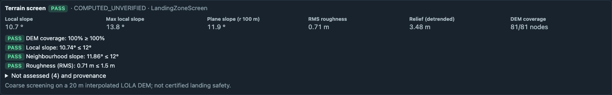
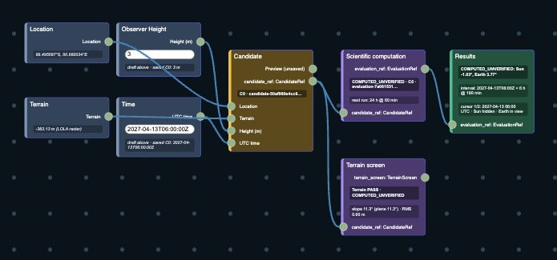
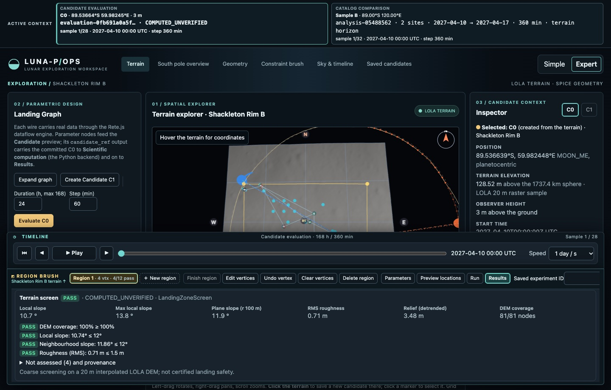

# Experiment B: terrain-aware adaptive sampling (controlled comparison)

Branch `feat/terrain-aware-brush`, built on the adaptive Region Brush milestone (`7cdbb8c`).
All results are `COMPUTED_UNVERIFIED`. The terrain screen is coarse screening on the 20 m
interpolated LOLA DEM (`LDEM_80S_20MPP_ADJ`), **not certified landing safety**.

## 1. What was compared

| | Experiment A | Experiment B |
| --- | --- | --- |
| `evidence` | `visibility` | `visibility_terrain` |
| Refinement policy | `spatial-lattice-evidence-v1` (the milestone policy, unchanged) | `spatial-lattice-evidence-terrain-v1` |
| Seeds | farthest-point seeds over the whole lattice | farthest-point seeds over lattice points that do not FAIL the terrain screen |
| Later locations | Sun/Earth verdicts, visibility/gap differences, constraint margins, horizon proximity | the same, plus terrain margins and normalized terrain metric differences; terrain-failing lattice points are never proposed; ties near a proposed location go to the larger terrain margin |
| Verdict reported | visibility verdict combined with the terrain screen (identical rule in both) | same |

Everything else was identical in each pair of runs: polygon, lattice, time interval, step, observer
height, attempt budget, visibility constraints, terrain constraints, DEM and SPICE kernels. Only
`evidence` differed. Both experiments apply the same combined feasibility rule after the fact, so
A is judged on the same criterion as B but cannot use terrain to choose where to evaluate. The
test suite checks that A's selection sequence is identical with and without terrain constraints,
so adding terrain screening does not alter the milestone policy.

## 2. Settings

- Region: 1.6 km × 1.6 km square centred on the Shackleton Rim B ROI centre (local −800…800 m),
  100 m lattice (289 points).
- Budget: 12 attempts, of which the last may be the existing temporal refinement.
- Interval: 168 h at 360 min steps (28 samples per full-window evaluation), observer 3 m.
- Visibility constraints: Sun ≥ 55 %, Earth ≥ 80 %.
- Terrain constraints (LandingZoneScreen): neighbourhood radius 100 m, local slope ≤ 12°,
  plane slope ≤ 12°, detrended RMS roughness ≤ 1.5 m, DEM coverage = 100 %. These are illustrative
  screening values, not mission requirements.
- Scenarios: start 2027-04-10 00:00 UTC (Sun fraction varies across the region, about 0.46–0.61
  at probe points) and 2026-11-07 00:00 UTC (Sun fraction ≈ 0 everywhere, so no location can meet
  the visibility constraint).

Terrain screen of the whole lattice (independent of time): **61 PASS, 228 FAIL, 0 NOT_ASSESSED**.
Most failures are slopes above 12° on the rim; DEM coverage is complete in this region.

## 3. Results

| Scenario | Exp. | Full-window attempts | Location-time samples | Visibility PASS | Terrain PASS | Attempts on terrain FAIL | **Combined PASS** | Best combined Sun fraction | Wall time |
| --- | --- | ---: | ---: | ---: | ---: | ---: | ---: | ---: | ---: |
| April 2027 | A | 11 | 310 | 4 | 1 | 10 | **0** | — | 4.9 s |
| April 2027 | B | 11 | 310 | 4 | 11 | 0 | **4** | 0.607 | 4.3 s |
| November 2026 | A | 11 | 310 | 0 | 2 | 9 | **0** | — | 4.3 s |
| November 2026 | B | 11 | 310 | 0 | 11 | 0 | **0** | — | 3.7 s |

Both experiments used the same number of attempts and the same number of location-time samples.
The twelfth attempt was the temporal refinement in every run (no full-window verdict).

- **April:** A found four locations meeting the visibility constraints, but all four were on slopes
  above 12° (combined FAIL). B also found four visibility passes, all on terrain that passes the
  screen, giving four combined passes, all marked non-dominated across the visibility and terrain
  objectives.
- **November:** no location in either run meets the Sun constraint, so neither finds a combined
  pass. B still spent no attempts on terrain-failing locations; A spent 9 of 11.
- Running A again gave the same November sequence as an earlier run, confirming that the
  selection is deterministic.

Every attempt in B records its reason, its parent candidate and evaluation IDs, and the IDs of the
terrain screens it used: its own location's screen and its parents' screens. Each screen ID is a
content hash of the DEM SHA-256, the algorithm, the location, the constraints and the metrics.
Full sequences are in [`terrain_aware_comparison.json`](terrain_aware_comparison.json).

## 4. Interpretation and limits

- Most of B's advantage here is structural: 79 % of this lattice fails the terrain screen, and A,
  which ignores terrain, spent 10 of its 11 April attempts there. Screening every lattice point
  takes well under a second, while one visibility evaluation costs about 0.4 s here, so terrain
  evidence is cheap relative to what it saves.
- This is one region, two time windows and one budget. It does not show that B is better in
  general. With gentler terrain, or terrain limits that most points pass, A and B converge.
- Excluding terrain-failing points means B can never report a location that is visibility-optimal
  but too steep. That is intended under these constraints but must be understood when comparing
  visibility-only optima.
- Terrain metrics come from a bilinear resampling of an interpolated 20 m grid. Features smaller
  than about 40 m are not resolved. DEM vertical uncertainty, LOLA track density, rocks and
  regolith properties are **NOT_ASSESSED**. Slopes are measured relative to the 1737.4 km
  reference sphere.
- Wall times are single, warm-cache runs and are not benchmarks.

## 5. Reproduce

With the isolated runner used during development (temporary `/data` in `tmpfs`, kernels and terrain
mounted read-only), from `backend/`:

```bash
python -m api.tests.terrain_comparison > terrain_aware_comparison.json
```

The script creates its own temporary database; it never touches `data/candidates.sqlite3`.

## 6. Verification

- `lunar-core/tests/test_landing_terrain.py`: exact slope of tilted planes at several local
  orientations, detrended roughness separated from regional tilt, missing DEM nodes never passing,
  verdict and margin rules, and vectorized results equal to single-point calls.
- `api/tests/test_terrain_screen.py`:
  - B never evaluates terrain-failing points, and every refinement cites terrain evidence.
  - A's sequence is unchanged by terrain constraints, and the combined verdict rule holds.
  - A missing DEM gives `NOT_ASSESSED`.
  - A real-DEM screen is reproducible, with provenance equal to the candidate's DEM SHA-256.
  - The candidate endpoint is read-only.
- Frontend unit tests: terrain card, Rete Terrain screen node memoization, brush definitions and
  restored legacy regions.
- Browser test `e2e/terrain.spec.ts` on the isolated stack: Experiment B preview, execution,
  result card and the Terrain screen node in the existing Landing Graph.

## 7. Interface

The terrain screen of the selected candidate in the Region Brush (Experiment B run, isolated stack):



The **Terrain screen** node in the existing Landing Graph, fed by `Candidate.candidate_ref`:



Workspace overview with the evaluated region and the result drawer:


